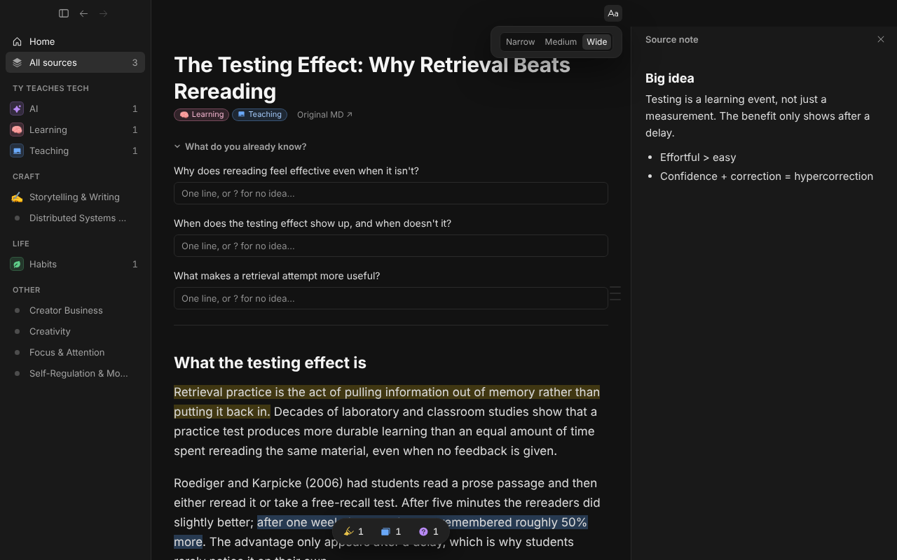

# Ore

A Mac learning app that turns what you read into things you remember. Capture anything (articles, PDFs, EPUBs, YouTube, notes), read it in a calm reader, highlight what matters, answer a few AI-written questions, and review AI-drafted cards on a spaced schedule (FSRS). Every design choice is checked against learning science; the evidence lives in [`docs/research/`](docs/research/).



**The core promise:** whatever you learn from comes in whole. Articles, YouTube and other video, podcasts, every kind of PDF, EPUB books, slides, documents and screenshots all import as robustly as Ore can make them, into one format built for learning: the content's own title and outline, its images, tables, math and code, and timestamps for anything that plays. If something can't come in, Ore says why and what to do instead, and never saves half of it.

It's a personal, single-user tool built by Tyler, mostly with Claude Code. It runs locally, with no accounts or API keys: your library is a folder of plain files (`~/Ore`), and AI runs through the `claude` or `codex` CLI you're already signed in to.

## Try it in 5 minutes

You need a Mac with Apple Silicon (M1 or later, macOS 13 or newer) and a paid Claude plan (Pro or Max) or a ChatGPT plan for the AI parts.

1. **Install Ore.** Download `Ore-<version>.dmg` from the [latest release](https://github.com/tyteachestech/ore/releases/latest), open it, and drag Ore into Applications.
2. **Open it.** Double-click Ore in Applications. If macOS says it can't check Ore for malware, click Done, open System Settings › Privacy & Security, scroll down and click **Open Anyway** next to Ore, then enter your Mac password. You only do this once.
3. **Give it an AI.** Open Terminal (press ⌘ Space, type Terminal, press Return), paste this line and press Return:
   ```
   curl -fsSL https://claude.ai/install.sh | bash
   ```
   Then type `claude`, press Return, and sign in with your Claude account in the browser window it opens. Close Terminal when it says you're signed in. (Using ChatGPT instead: install [Codex](https://github.com/openai/codex), sign in, and pick Codex in Ore's Settings › AI.)
4. **Add 5 sources.** In Ore press ⌘N, paste a link to an article or a YouTube video, and press Return. Do it 5 times, or drop PDFs, EPUBs, Word files or slides onto the window. Each one lands in **To read**, and after a few seconds the AI adds a few questions to think about before you read it.
5. **Read one and make a card.** Open a source, select a sentence worth remembering, and pick **Card**. When you reach the end, press ⇧⌘Return to finish it: write what you remember and answer its questions. The AI then turns your Card highlights into flashcards, in about a minute.
6. **Do a review.** Press ⌘R. Answer the card, say how sure you were (1 to 3), and rate how it went (1 Again to 4 Easy). Ore brings it back just before you'd forget it.

Your library is the folder `Ore` in your home folder: plain files you own. Nothing leaves your Mac except what the AI reads to help you.

## The loop

1. **Capture.** Paste a URL or drop a file. AI drafts 2 to 4 broad *prequestions* and tags the source with your skills.
2. **Read.** Try the prequestions first, then read. Select text to highlight it as Keep, Card or Question, with an optional note.
3. **Finish.** The source blurs; you write what you remember, then answer each prequestion and check it against the passages it came from.
4. **Review.** Cards from your highlights and notes come back on an FSRS schedule. Fact cards are flipped; Explain cards are typed and checked against a rubric by AI. You always set the rating.
5. **Grow.** Each skill shows its *strength* as gems: one cut gem per memory you'd still recall three weeks out. No streaks, XP or leaderboards.

Glossary: [`CONTEXT.md`](CONTEXT.md).

## Running it

Requirements: macOS, [Bun](https://bun.sh) 1.4.4 (the version CI uses), and for the desktop app [Rust and the Tauri 2 prerequisites](https://v2.tauri.app/start/prerequisites/). For the AI features, the [`claude`](https://code.claude.com) or [`codex`](https://github.com/openai/codex) CLI, signed in.

```bash
bun install                     # workspace deps
bun test                        # all tests
bun run typecheck               # tsc strict, whole workspace

cd packages/cli && bun link     # puts `ore` on PATH
ORE_LIBRARY=/tmp/lib ore init   # a scratch library to play with
ore --help                      # every command accepts --json
```

The desktop app, against that scratch library:

```bash
cd apps/desktop && ORE_LIBRARY=/tmp/lib bun run tauri dev
```

`bun run app:install` builds the app and installs it to `/Applications/Ore.app`. Without `ORE_LIBRARY` it uses `~/Ore`.

No Mac or no Rust? The UI also runs in a plain browser against a seeded fake library: see [`apps/desktop/scripts/mock/README.md`](apps/desktop/scripts/mock/README.md).

Pick the AI vendor with `ai: claude` or `ai: codex` in the library's `skills.yaml` (or `ORE_AI=codex`).

## Releasing

Push a version tag and GitHub builds the app and attaches `Ore-<version>.dmg` to a release (`.github/workflows/release.yml`): set `version` in `apps/desktop/src-tauri/tauri.conf.json`, then `git tag v0.1.0 && git push origin v0.1.0`. **Actions › release › Run workflow** builds one to try without releasing. The release app carries its own `ore` (a compiled single file, `apps/desktop/scripts/bundle-cli.ts`), so it needs no Bun or checkout. `app:install` builds the same way, so an installed app runs its compiled `ore` too; `tauri dev` runs the linked checkout's.

Without Apple secrets the build is signed ad hoc, and each friend clicks Open Anyway once (step 2 above). To sign and notarize it so it opens with no warning, add these repository secrets (Settings › Secrets and variables › Actions); the next tag uses them:

| Secret | What it is |
| --- | --- |
| `APPLE_CERTIFICATE` | Your *Developer ID Application* certificate exported from Keychain Access as a `.p12`, then `base64 -i cert.p12 \| pbcopy` |
| `APPLE_CERTIFICATE_PASSWORD` | The password you gave the `.p12` |
| `APPLE_SIGNING_IDENTITY` | Its name, e.g. `Developer ID Application: Your Name (TEAMID)` (`security find-identity -v -p codesigning`) |
| `APPLE_ID` | The Apple Account email of your developer membership |
| `APPLE_PASSWORD` | An app-specific password for it, made at [account.apple.com](https://account.apple.com) › Sign-In and Security |
| `APPLE_TEAM_ID` | Your 10-character Team ID ([developer.apple.com/account](https://developer.apple.com/account) › Membership details) |

## Repo layout

```
packages/core    domain, storage, ingest, anchoring, scheduling, AI adapter and prompts
packages/cli     the `ore` command-line tool (thin over core)
apps/desktop     Tauri 2 + React app
skills/ore       Claude Code skill: quizzing and library work from the terminal
docs/            decisions, spec, research, design docs, reviews
```

## Docs

Start with **DECISIONS** (what was decided and why) and **SPEC** (how it's built).

| Doc | What it is |
| --- | --- |
| [`docs/DECISIONS.md`](docs/DECISIONS.md) | Every settled decision, D1 onward. The source of truth |
| [`docs/SPEC.md`](docs/SPEC.md) | Data model, library layout, CLI, scheduling, AI adapter |
| [`CONTEXT.md`](CONTEXT.md) | Glossary: source, highlight, intent, prequestion, finish, skill… |
| [`PRODUCT.md`](PRODUCT.md) · [`DESIGN.md`](DESIGN.md) | Product brief and design system (tokens, components, states) |
| [`AGENTS.md`](AGENTS.md) | Working agreement for AI coding agents: rules, UI quality bar, interaction checklist |
| [`CONTRIBUTING.md`](CONTRIBUTING.md) | Reporting a broken import, setting up, and what a pull request needs |
| [`docs/WORKFLOW.md`](docs/WORKFLOW.md) | How the maintainer's threads merge and reinstall the app |

**Research** ([`docs/research/`](docs/research/)): the evidence behind the decisions.

| Doc | Topic |
| --- | --- |
| [`brief-learning-science.md`](docs/research/brief-learning-science.md) | The main evidence brief: retrieval, spacing, feedback, prequestions, motivation, what doesn't work |
| [`brief-ai-tutor.md`](docs/research/brief-ai-tutor.md) | The tutor chat: when AI help helps learning, products and code to borrow, design calls |
| [`skill-strength.md`](docs/research/skill-strength.md) | Which growth metric motivates without gaming (led to D63) |
| [`skill-metrics-motivation.md`](docs/research/skill-metrics-motivation.md) | Round 2: a near goal for strength (led to the gems, D90) |
| [`brief-notetaking.md`](docs/research/brief-notetaking.md) | Active note-taking, with [evidence](docs/research/brief-notetaking-evidence.md), [practice](docs/research/brief-notetaking-practice.md), and checks against [Ahrens](docs/research/brief-notetaking-check-ahrens.md) and [Fiorella & Mayer](docs/research/brief-notetaking-check-fiorella-mayer.md) |
| [`brief-diagramming.md`](docs/research/brief-diagramming.md) | Learner-made diagrams and maps: [evidence](docs/research/brief-diagramming-evidence.md), [tools](docs/research/brief-diagramming-tools.md) |
| [`brief-landscape.md`](docs/research/brief-landscape.md) | Existing apps (Readwise, Anki, RemNote…) and what to take from them |
| [`brief-tech.md`](docs/research/brief-tech.md) | Stack options: Tauri vs others, FSRS, ingest, local AI |
| [`brief-notionrpg-engram.md`](docs/research/brief-notionrpg-engram.md) · [`brief-notetaking-notionrpg.md`](docs/research/brief-notetaking-notionrpg.md) | Tyler's earlier tools, and what carried over |
| [`tp-learn-reference-map.md`](docs/research/tp-learn-reference-map.md) | Open-source projects studied as references |

**Design docs** ([`docs/design/`](docs/design/), [index by area](docs/design/README.md)): proposals Tyler approved, with the reasoning.

| Doc | Status |
| --- | --- |
| [`daily-session.md`](docs/design/daily-session.md) | Who Ore is for and the daily session: a 10 min to 1 hour habit over a due backlog that never empties (D144) |
| [`learning-system.md`](docs/design/learning-system.md) | The learn-and-apply loop the science asks for, what Ore has of it, and which rewards are safe to tune (proposed) |
| [`review-plan.md`](docs/design/review-plan.md) | Home, Review mode, daily goal, "Ask about this" chat, delight rules (D58 to D62, built) |
| [`in-reader-quiz.md`](docs/design/in-reader-quiz.md) | The finish quiz with the blurred source (D52 to D57, built) |
| [`questions-to-research.md`](docs/design/questions-to-research.md) | Answering questions in the reader's side panel and on the skill page, matched sources, Answered + card (D75, built) |
| [`signature-style.md`](docs/design/signature-style.md) | The look being re-picked: Tyler's brief, picks so far, what it amends (in progress) |
| [`remixing-cards.md`](docs/design/remixing-cards.md) | Fresh variants of known cards to build transfer (D66, built) |
| [`courses-and-live-links.md`](docs/design/courses-and-live-links.md) | Courses as ordered lesson sources, and live links (D79 built; live links not now) |
| [`key-points-and-stopping-early.md`](docs/design/key-points-and-stopping-early.md) | The Collected tab, Card here, and finishing a source before its end (D99, D100, built) |
| [`side-quests.md`](docs/design/side-quests.md) | Marking a term you don't know yet and chasing it now or later (D97, built) |
| [`skill-goals-and-parts.md`](docs/design/skill-goals-and-parts.md) | A goal per skill; parts deferred (D102, built) |
| [`feeds-and-newsletters.md`](docs/design/feeds-and-newsletters.md) | The Feed: RSS and newsletters, posts saved only once highlighted (D107, built) |

**Reviews** ([`docs/reviews/`](docs/reviews/)): audits of the app at a point in time. Some findings are fixed since.

| Doc | What |
| --- | --- |
| [`2026-10-24-foundation-check.md`](docs/reviews/2026-10-24-foundation-check.md) | Architecture and risk review |
| [`2026-10-24-science-audit.md`](docs/reviews/2026-10-24-science-audit.md) | Does the app follow the science? Review-load simulation and 8 ranked recommendations |
| [`2026-10-24-design-critique.md`](docs/reviews/2026-10-24-design-critique.md) | UX heuristics critique (26/40) |
| [`2026-10-24-interaction-audit.md`](docs/reviews/2026-10-24-interaction-audit.md) | Create, rename, move, delete and undo for every object |
| [`2026-10-25-design-critique.md`](docs/reviews/2026-10-25-design-critique.md) · [round 3](docs/reviews/2026-10-25-design-critique-round-3.md) · [round 4](docs/reviews/2026-10-25-design-critique-round-4.md) | UX critique rounds 2 to 4 (28, 30, 30 of 40) |
| [`2026-10-26-motion-review.md`](docs/reviews/2026-10-26-motion-review.md) | Every animation against Emil Kowalski's standards |
| [`2026-10-27-stress-test.md`](docs/reviews/2026-10-27-stress-test.md) | Stress test and foundation check after the iPhone build |
| [`2026-10-28-import-coverage.md`](docs/reviews/2026-10-28-import-coverage.md) | What 53 real links and files keep and miss on import, and the plan to close the gaps |
| [`2026-10-29-edge-cases.md`](docs/reviews/2026-10-29-edge-cases.md) | Edge cases: damaged and hand-edited files, fixed at the shared readers and writers |
| [`2026-10-29-skill-goals-stress-test.md`](docs/reviews/2026-10-29-skill-goals-stress-test.md) | The skill goals and parts proposal walked through real use |
| [`2026-11-01-bug-sweep.md`](docs/reviews/2026-11-01-bug-sweep.md) | Six parallel bug sweeps, every screen |
| [`2026-11-02-science-pass.md`](docs/reviews/2026-11-02-science-pass.md) | Second science audit: new features, the draft pile, 8 ranked recommendations |
| [`2026-11-06-import-promise.md`](docs/reviews/2026-11-06-import-promise.md) | The core promise (D122) checked against today's import, with the gaps ranked |
| [`2026-11-06-notion-parity.md`](docs/reviews/2026-11-06-notion-parity.md) | The note editor checked block by block against Notion |
| [`2026-11-08-design-critique-round-5.md`](docs/reviews/2026-11-08-design-critique-round-5.md) | UX critique round 5 (28/40) |
| [`2026-11-08-shadcn-components.md`](docs/reviews/2026-11-08-shadcn-components.md) | shadcn-ecosystem components pitched for the learning loop, and which were picked (D141 to D143) |
| [`2026-11-08-stress-test.md`](docs/reviews/2026-11-08-stress-test.md) | Six-area stress test: 84 findings, the PRs that fixed them, and the design calls (D144) |


**Guidebooks** ([`docs/guidebooks/`](docs/guidebooks/)): four evidence-based books the research briefs draw on (Learning Science, Teaching, Gamification, UX and UI Design), each with its paper summaries and source lists.

**Guides**: [`docs/guides/ai-user-testing.md`](docs/guides/ai-user-testing.md) (usability testing with an AI agent driving the app) and its [iPhone version](docs/guides/ai-user-testing-iphone.md), the AI evals ([grading](docs/guides/grading-eval.md), [Ask your library](docs/guides/ask-library.md), [tutor](docs/guides/tutor-eval.md), [question quality](docs/guides/question-eval.md)), [`skills/ore/README.md`](skills/ore/README.md) (the `/ore` Claude Code skill), [`apps/desktop/scripts/mock/README.md`](apps/desktop/scripts/mock/README.md) (the mocked app for screenshots).

## Contributing

A link or file that didn't come in whole is the most useful report: open an issue with the **A source came in broken** form. Setup and what a pull request needs: [`CONTRIBUTING.md`](CONTRIBUTING.md).

## License

Ore is free software under the [GNU AGPL v3.0 or later](LICENSE) (D120). You may use, change and share it; a copy you share or run for others must stay open under the same license.

"Ore" and its icon name this project. A fork is welcome but must use another name.
