# Key points and stopping early (2026-10-29)

Tyler, 70% through a 52-minute REST API video, ran into two gaps.

1. **A key point that spans minutes.** The speaker spent five minutes on "the three benefits of putting an API in front of the back end". Tyler wants to jot that one line and get a card, without highlighting exact sentences and hoping the AI stitches them together. The card must stay grounded: in review he checks his answer against the exact parts of the source. NotionRPG had this as its main type: a **Key Point** with a free title, gathering one or more References (passages), and the only thing that could make flashcards.
2. **Stopping before the end.** He doesn't need the coding part. He wants to be done, with cards from the theory only. Back in the list, the row showed the kind ("video") floating at the right and nothing saying he was 70% in.

He asked for one or two flows that cover every variant, not a feature per case.

Mockups are in `docs/images/key-points/` (also the project's `key-points/` folder), drawn over the real app in the mock harness with his video.

## What exists already

- **Three highlight types** (D91): Keep, Card, Question. D97 rules out a fourth.
- **A Card is drafted by AI** from its passage and note (D19, D20), and its first review is the finishing step.
- **Finish** (D18, D52 to D56, D71): recall, then each prequestion with Check, which shows key points backed by **exact quotes the app verifies** against the text (`key-points` prompt). "Just mark done" skips the quiz and still drafts cards from his highlights.
- **Archive** (D74) puts a source away with nothing drafted.
- Home's Continue reading already shows a progress bar. The skill page and All sources rows don't.

So the missing pieces are small: a card that starts from a line instead of a selection, and a finish that knows how far he got.

## What the science says

| Finding | Evidence | What it means here |
|---|---|---|
| Stopping to write down the main idea of a chunk helps | Pausing a lecture every ~12 min for students to rework notes raised recall (pause procedure, Ruhl, Hughes & Schloss 1987). Generating a summary of a segment is a moderate generative-learning effect (Fiorella & Mayer 2016). | His "the three benefits…" line is the learning move. It should take one key and no selection. |
| Feedback after the attempt is what makes retrieval correct itself | Feedback with the right answer after a test sharply improves later recall, most after errors (Pashler et al. 2005; Butler & Roediger 2008). | The card's answer must point to the exact passages, and they show only after he answers (D34.3). |
| Lists are hard cards | Enumerations and sets are the classic failing flashcard; use a prompt that asks for each item (Wozniak, "20 rules", practitioner). | "The 3 benefits" becomes an Explain prompt with one rubric point per benefit, each with its own quote. |
| Reading for a goal is fine; skipping is fine | Readers told what's relevant learn the relevant parts better and skim the rest, with no loss on what matters (McCrudden & Schraw 2007). | Stopping at 70%, or skipping the code, is good learning, not a failure to finish. The app should make it a normal ending. |
| Questions on what he never read teach nothing | Prequestions help only what they target and only once it's read (St. Hilaire et al. 2024). Testing without exposure gives no feedback to learn from. | A partway finish must drop questions whose answers lie past where he stopped, and never draft cards from them. |
| Open loops nag; a plan closes them | Unfinished goals stop intruding once a plan exists (Masicampo & Baumeister 2011). | "Done for now" should be an explicit ending with a visible place to come back to, not a guilty half-read row. |

## Part 1: a key point that spans minutes

### A. Card here, from a line (recommended)
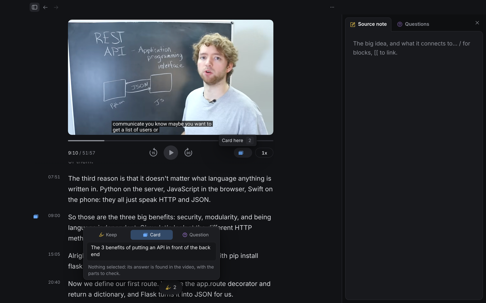
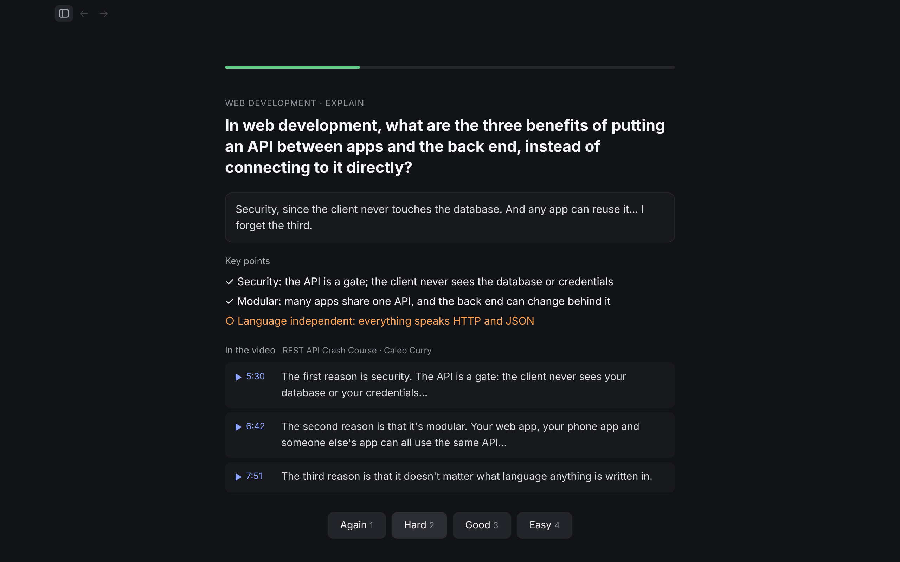

With nothing selected, **Card here** (key 2, a card button in the video's control row, ⌘K, right-click on text) opens the usual popup with Card chosen and the field focused: "What to remember…". He types the point; ↵ saves. It is a Card like any other, anchored where he is (the line being spoken, or the paragraph a third down on text), with a Card mark in the gutter.

When it's drafted, the AI writes the question from his line and the answer from the **whole source**, and returns the exact quotes that support each point. The app keeps only quotes it finds in the text (as the finish key points already do). In review, after he answers, the key points show with each quote under them; a timestamp plays the video from there, a text quote opens the source at it.
- Good: one key, no selection, no new type. Works for videos, articles, books, PDFs. Grounding is checked by code, not trusted from the AI.
- Weak: depends on AI to find the passages. Without AI it stays a card with his line, anchored at the moment he typed it, and drafts when AI is back. If a quote is wrong he removes it on the first review.

### B. Key point gathers passages (NotionRPG)
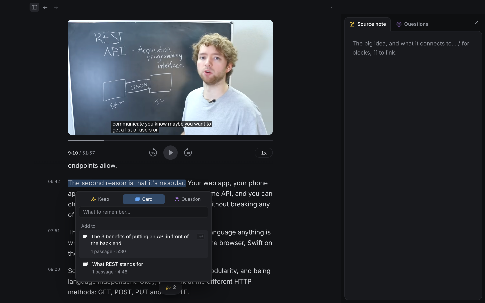

He types the key point once, then selects each supporting passage and picks **Add to** that key point in the popup.
- Good: he chooses every passage, exactly NotionRPG's model.
- Weak: the very thing he asked not to do (hunt down each sentence). Adds a list to the popup on every selection. Better kept as a later fix-up on A ("Add passage") if AI grounding misses.

### C. Mark a stretch

Press the card button where the idea starts ("From 5:30"), again where it ends; the card covers everything in between.
- Good: precise, no AI needed for grounding.
- Weak: he has to know it's a key point when it starts, which he usually doesn't (he realised at 9:00). Two presses. Doesn't fit text as well.

## Part 2: stopping early, one flow for every case

### A. Finish covers what you reached (recommended)
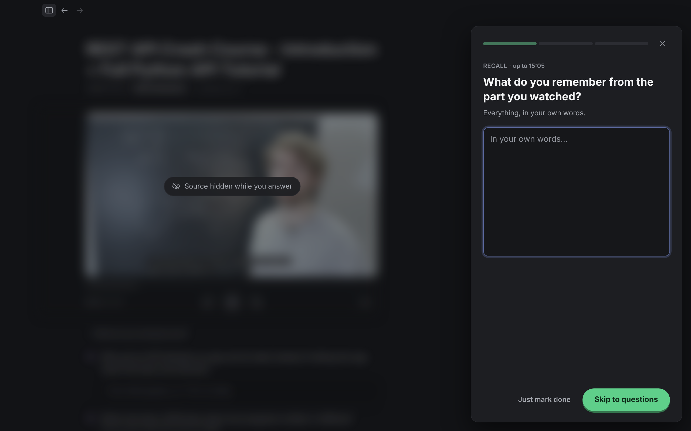
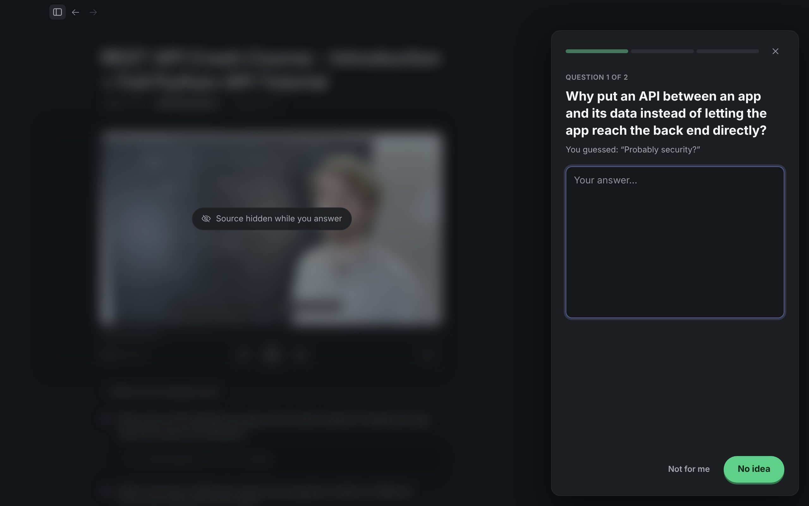
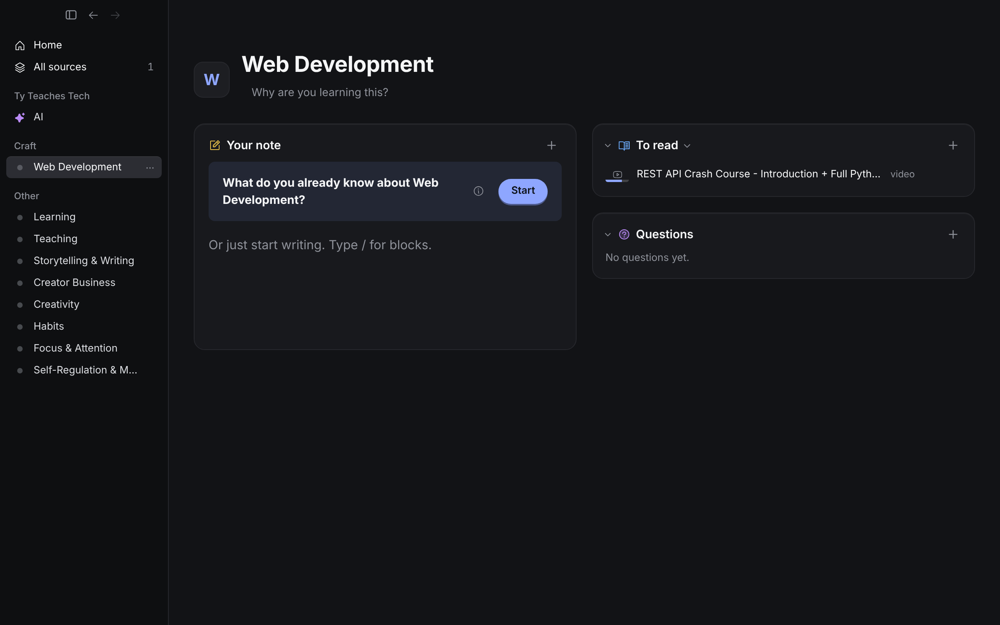

Finish (⇧⌘↵, ⋯, ⌘K; on a video also in the control row once he's past the start) works at any point. The app keeps how far he **reached** (the furthest point played or scrolled, not the current one). Before the end, the quiz says "up to 15:05", the recall asks about "the part you watched", and any prequestion whose verified quotes all lie past that point is dropped, so no quiz question or card comes from the code he skipped. Each question gets **Not for me** beside No idea: skipped, no card. The closing card (D71) is unchanged.

Every variant maps onto three things that exist plus this one change:

| He wants to… | He does |
|---|---|
| Stop at 70%, cards from what he watched | Finish |
| Skip around, or only cares about some parts | Finish; Not for me on a question he doesn't want; his own cards and Card here lines are what he picked |
| Stop with no quiz, cards from his marks | Finish → Just mark done |
| Drop it, no cards | Archive |
| Come back later | Just leave. The row shows how far he got (a bar under the thumbnail, as YouTube and Home's Continue reading do) |
| Reopen a finished source and watch more | Finish again covers from where the last finish reached |
| Long book | Chapter recalls as now; a partway finish covers up to the last chapter reached |
| Course | Each lesson is its own source (D79): the same Finish per lesson; skip a lesson with Archive |

- Good: one action, no choice to make before quitting, and the guard (quotes past the point) is checked by code. Nothing new on screen except "up to 15:05", Not for me, and the row bar.
- Weak: "reached" is the furthest point, so jumping ahead to peek at the end makes everything count; Not for me covers that.

### B. A Finish menu with three endings
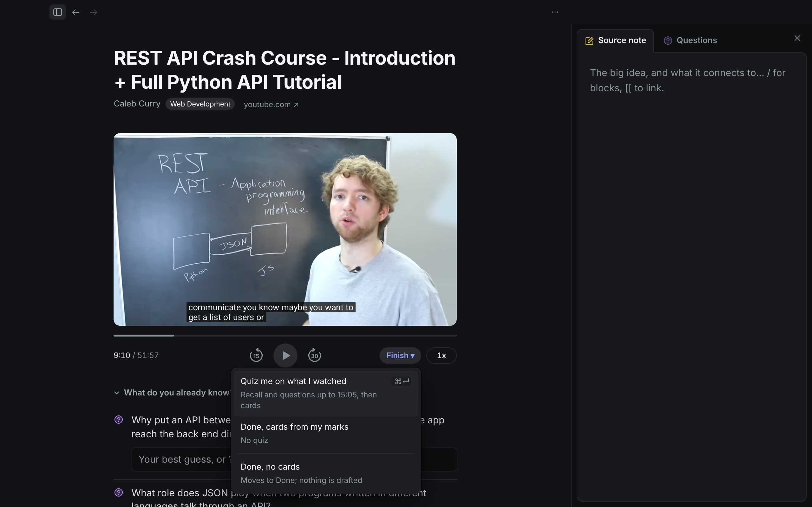

Finish becomes a menu: Quiz me on what I watched, Done with cards from my marks, Done with no cards.
- Good: every ending named in one place.
- Weak: a choice every time he finishes, and two of the three already exist (Just mark done, Archive). Three items to read where one key works today.

### C. Pick the parts
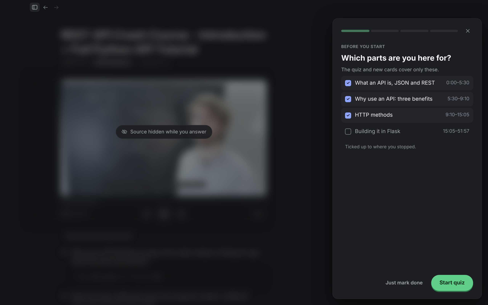

Finish opens with the source's sections, ticked up to where he stopped; the quiz and cards cover only the ticked ones.
- Good: handles skipped middles exactly.
- Weak: needs sections (videos without chapters would need AI to cut them), and a list to review before every finish. A's Not for me covers the same cases with no extra step.

## Recommendation

**Part 1 A + Part 2 A.** One new action (Card here) and one smarter one (Finish knows how far he reached). Both reuse what's built: the popup, the Card type, verified quotes, Just mark done, Archive. Add the row's progress bar so "how far am I" shows wherever the source is listed.

## Not doing
A fourth highlight type (D97.6), a mini player, a "time left" or % read (D27, D51), counts of unfinished sources, and AI deciding what he cares about.

## Round 2: Tyler's design, merged (2026-10-29)

Tyler sketched his own before reading the above: a side panel tab of everything collected, grouped (Cards, Questions, Keeps), each row jumping to its passage, plus cards he writes himself; at Done an optional step with how far he got and a note to the AI ("ignore the programming, I just want theory"); and first-time cards he can delete or send back to the AI with feedback.

What already exists: drafts show **New** in review and their first answer is the check step (D20), with Edit; prequestions already become content cards for the central ideas (D19). Catches: the "leave out" note must come before the quiz, or the quiz asks about the part he wants skipped; count pills fail the purpose rule when the tab already shows the items; a self-written card needs an anchor, so it takes his current spot and the AI attaches verified quotes (Card here); more content cards grow review load, so they stay at the 2 to 4 central ideas and obey the note.

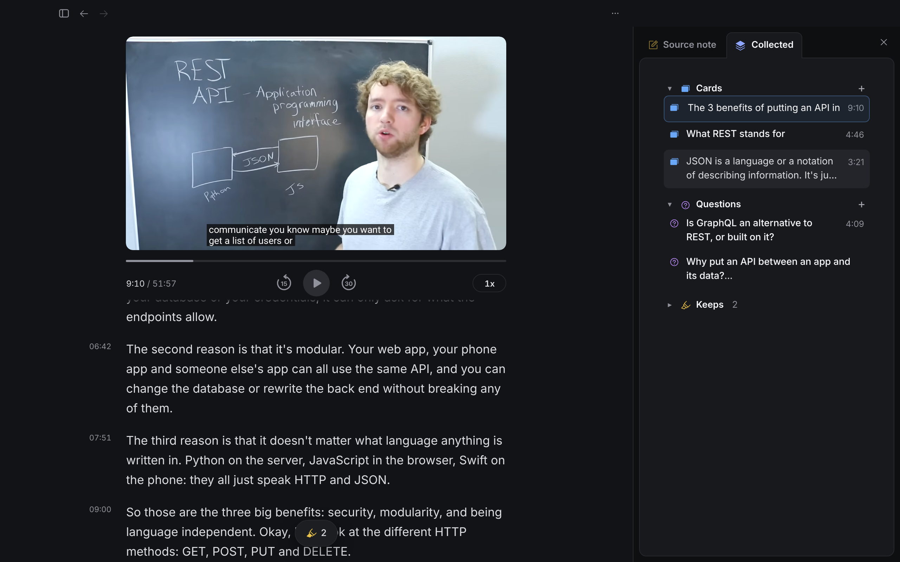
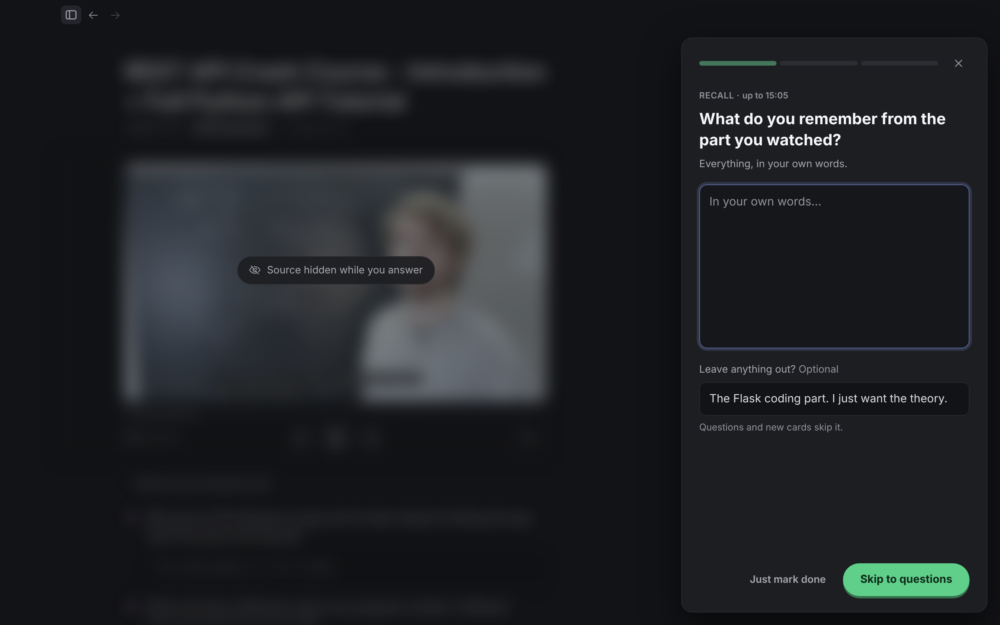
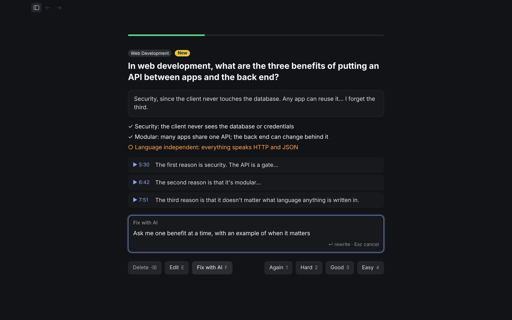

1. **Collected tab** (replaces the Questions tab): Source note | Collected. Groups Cards, Questions, Keeps, collapsible, his order kept. A row jumps to its passage (or plays the video there). **+** on Cards is Card here: a new row at his current spot, name field focused. Questions keep their answers and "May be answered here" inside their group.
2. **Finish**: "up to 15:05" (the furthest point reached) and an optional **Leave anything out?** line under the recall. Prequestions whose quotes all lie past the reached point, or that the note rules out, are dropped; drafts follow the note. The note is saved with the source and its AI stamp.
3. **New cards in review**: **Delete** (Undo) and **Fix with AI** (F): he types what's wrong, the AI rewrites the card (vendor, model, prompt version recorded), and the rewrite is what he answers next time.
