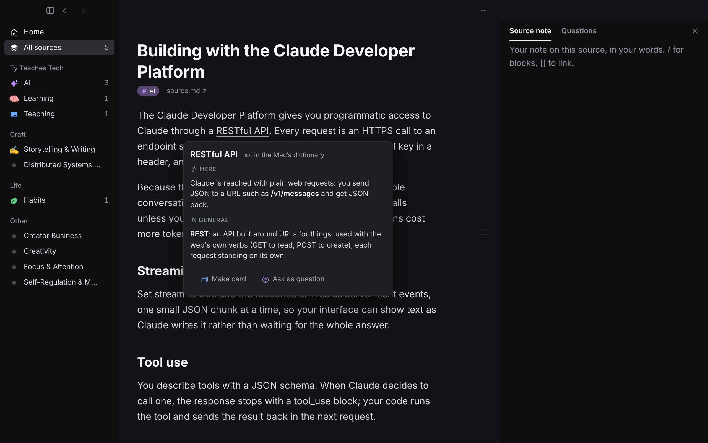
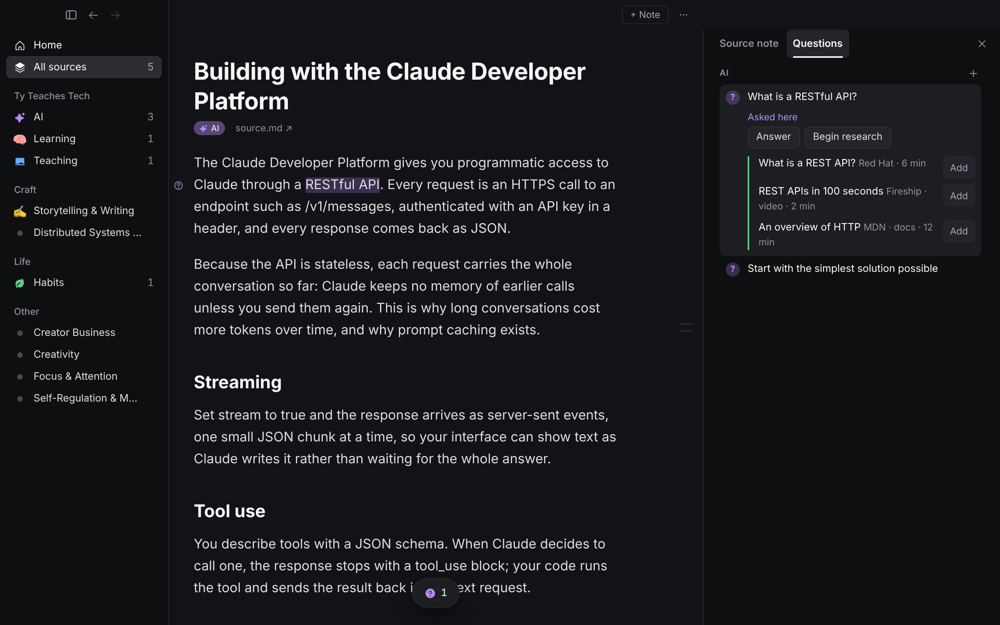
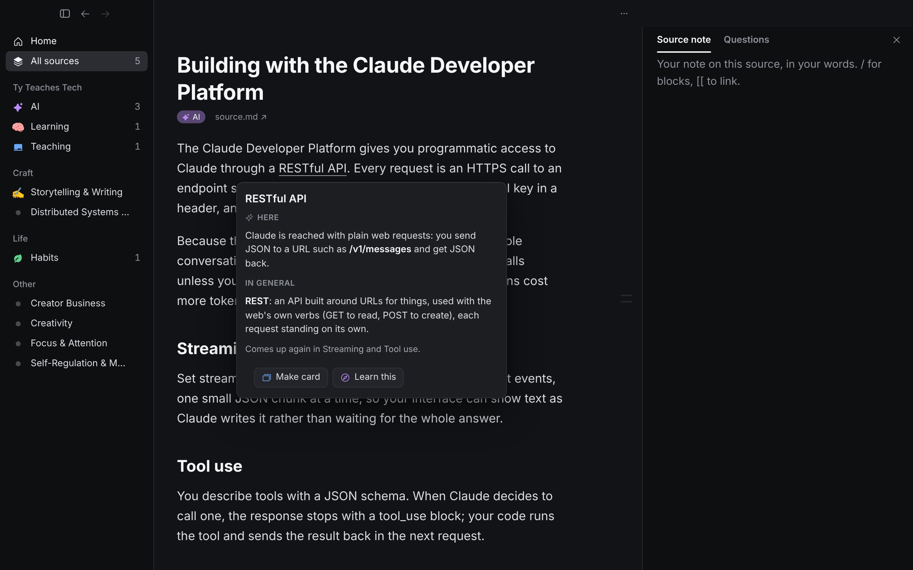
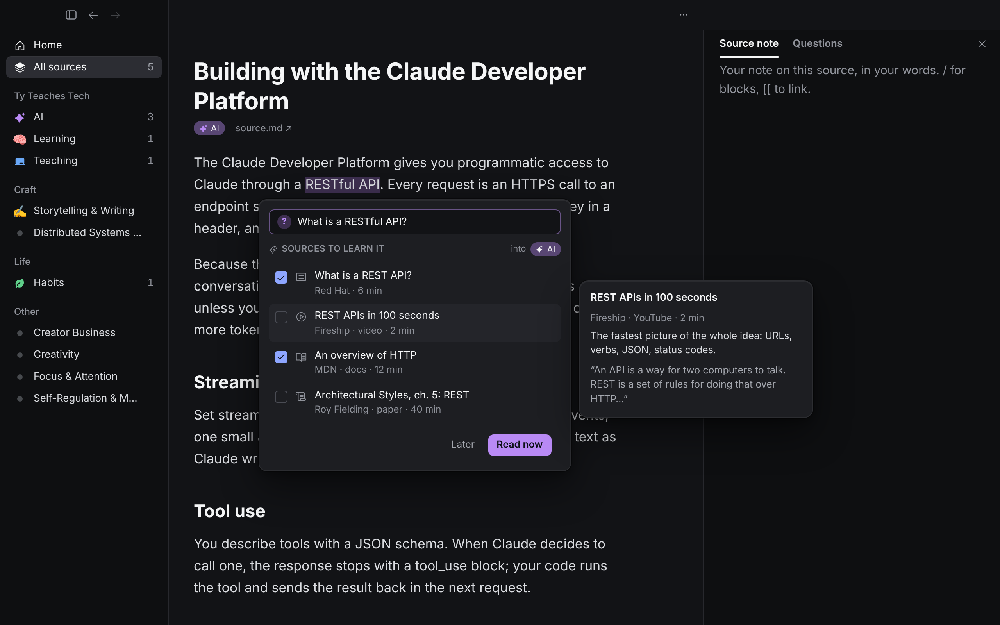
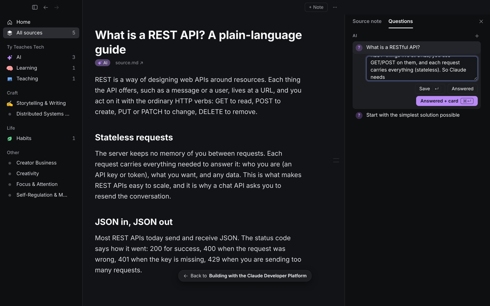
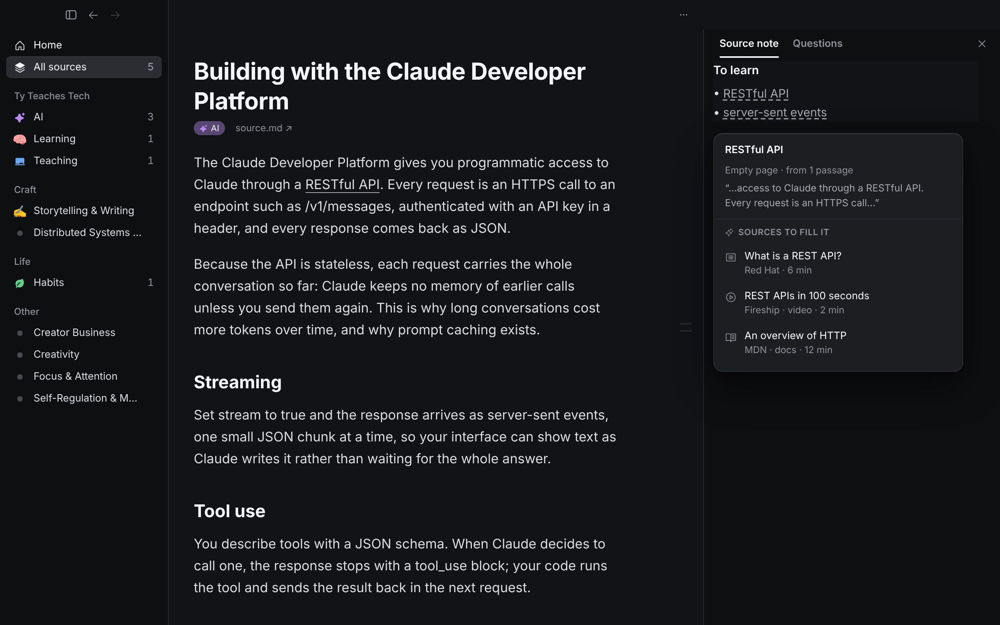

# Side quests: a term he doesn't know yet (2026-10-28)

Tyler, reading about the Claude platform, hits "RESTful API" and doesn't know what REST means. He wants to mark it as something to learn, get suggested sources (peek at each, pick several), and either go now ("side quest") or leave it for later, as Obsidian lets you leave an empty page while reading.

**Picked B on 2026-10-28; built as D97.** Screens of the build are in `docs/images/side-quests/built/`.

Mockups are in `docs/images/side-quests/` (also the project's `side-quests/` folder), drawn over the real app in the mock harness.

## What the science says

**Short answer: get the gist now, learn it properly later, and only stop to learn it properly when the rest of the text depends on it.** Marking it and moving on is not enough when the term is load-bearing; leaving the source for a full side quest every time costs the thing he was reading.

| Finding | Evidence | What it means here |
|---|---|---|
| Gaps in what you already know cap comprehension | Readers need ~98% of the words to understand a text unassisted (Hu & Nation 2000). Prior knowledge beat reading skill in Recht & Leslie 1988 (the baseball study). | An unknown key term really can block the rest of the source. Ignoring it isn't free. |
| A short gloss right where you read helps | Glosses beside the text improved comprehension (d ≈ 0.73) and word learning (d ≈ 1.40) in a meta-analysis of computer glosses (Abraham 2008, L2 reading). | A two-sentence explanation in place is the cheapest way through. Moderate, mostly from language learning. |
| Learning the key terms first makes the lesson land | Pre-training: knowing a lesson's key concepts beforehand improved transfer in 5 of 5 tests, median d = 0.85 (Mayer, *Multimedia Learning*). | When the term is central (it keeps coming up), learning it before going on pays. That is the case for "go now". |
| Leaving the text mid-thought hurts understanding of it | 15-second interruptions cut comprehension of how a text's ideas connect (d = 1.4 to 2.4), not memory for facts; letting the reader finish their thought first removed the cost (Foroughi et al. 2015). Following links adds load and hurts readers with low prior knowledge most (DeStefano & LeFevre 2007). | A side quest should start at a stopping point and come back to the exact spot. The person with the gap is exactly the reader links hurt most, so "go now" should be a choice, not the default. |
| Curiosity fades fast | People want information now and much less after a delay (Molnar & Golman 2024, two preregistered studies, N = 2,406). Curiosity improves memory for the answer (Gruber et al. 2014). | Answer the itch now with the gloss. If he defers, the question he saved keeps the gap alive as a prequestion. |
| A question you carry makes the later source stick | Prequestions improve learning of what they ask about, g = 0.54 (St. Hilaire et al. 2024). Already the basis of D75. | "Later" should save a question, not a bookmark: it pays off when he reads the REST source. |
| Writing it down frees the mind, but only with a plan | Unfinished goals stop intruding once a specific plan exists (Masicampo & Baumeister 2011). | A "later" item needs its next step attached (sources picked, filed under a skill), not just a name. |
| Empty pages and links don't teach by themselves | Storing links has no learning effect (Bisra 2018, via the NotionRPG brief). Open-question piles cut persistence (Janelli & Lipnevich 2021, one study). | Obsidian-style stubs are navigation, not learning, and can become a guilt pile. Menu, not backlog (D75.6). |

So the moves are:
1. **Gist now, in place.** A short explanation in this sentence's context, without leaving the source.
2. **Decide with a cue.** Whether the term comes up again in this source is the best cue for "go now" (pre-training); the app can say so.
3. **Later = a question with sources picked.** Not an empty page.
4. **Go now = from a stopping point, with a way back to the exact spot.** What he writes there answers the question (D75), so the detour is learning, not browsing.

## The options

### A. Look up explains; "Ask as question" (smallest)

Look up (D83) adds an AI gloss under the dictionary entry: **Here** (what it means in this sentence) and **In general**. Beside Make card, **Ask as question** turns the highlight into a Question with "What is a RESTful API?" filled in. Sources come from today's **Begin research** in the Questions tab, added one at a time.
- Good: almost nothing new. Lifts D83.5's "not yet: AI explanation in context".
- Weak: no peek, no multi-pick, and "go now" means hunting through the Questions tab, so the side quest Tyler described doesn't exist.

### B. Explain, then "Learn this" (recommended)

1. **Explain** (the Look up button and ⌃⌘D, renamed): the same gloss as A, plus one line, "Comes up again in Streaming and Tool use", when it does. That line is the cue for going now. Buttons: **Make card** (as today) and **Learn this**.
2. **Learn this** makes the highlight a Question, "What is a RESTful API?" (editable, his guess can go after it as today), and opens 3 to 5 suggested sources in place (D17 research). Each row has a checkbox; hovering or arrowing onto one shows a D88-style peek: what it gives him that the others don't, and its first lines. "into AI" shows the skill they'll be filed under (the source's skills; click to change, as in the add box, D89).
3. Two ways out: **Later** adds the picked sources to To read, linked to the question (`add --for`, D75), and he keeps reading. **Read now** (↵) does the same and opens the first pick.
4. **The side quest.** The new source opens with a **Back to "Building with…"** pill (the video's Back to current pill), which returns to the exact passage and flashes it; ⌘[ does the same. The Questions tab opens on his question, so what he writes there answers it and links the source (D75). Answered + card makes it reviewable.
- Good: every piece Tyler asked for (mark, suggestions with peeks, multi-pick, go now or later, linked back), built from parts that exist: Question, D17 research, D75 answers and `--for`, D88 peek, D89 skill pick, the Back pill.
- Cost: the gloss is a new AI call (fast, one sentence of context); research takes 10 to 40 s with web search, so the list shows "Finding sources…" with the question already saved. He can leave and the list waits in the Questions tab.

### C. Obsidian-style empty page

**Make page** adds `[[RESTful API]]` under "To learn" in the source note (dashed: empty). Its peek shows the passage it came from and sources to fill it. Filling the page is the learning.
- Good: familiar to Obsidian users; a term page can collect every place the term comes up.
- Weak: a new kind of object with its own full lifecycle (rename, merge, delete), overlapping skill notes; empty pages are the backlog the evidence warns about; no gist now; and it duplicates Questions, which already do this job.

## Recommendation: B

B is the only option that does all four moves: gist now, a cue for going now, a later that is a question with a plan, and a side quest that returns to the spot. It adds no fourth highlight type (D91 just went to three), and no new object: a term he doesn't know is a question he hasn't asked yet.

Purpose check (each element, one line):
- **Here / In general**: the gist, so he can keep reading.
- **Comes up again in…**: tells him whether to go now. Shown only when true; not a count.
- **The question field**: what the later source will answer; editable so it's his.
- **Source rows + peek**: choose without opening each one.
- **into AI**: where the sources will be filed, changeable before adding.
- **Later / Read now**: the choice he asked for.
- **Back to … pill**: the way back to the exact spot.

Left out on purpose: counts of open terms, a "to learn" list on Home, due dates, auto-adding sources (D17: AI suggests, he picks).

## Rules and edge cases
- **AI never answers for him (D75.5).** The gloss is reading support, like the dictionary: it is not saved as his answer and never becomes a card by itself. Make card from Explain uses the sentence, as Look up does today.
- **No AI** (signed out, offline): Explain shows the Mac dictionary only and says "Explanation needs AI"; Learn this still saves the question and says sources will come when AI is back, with Retry.
- **Research fails or finds nothing**: says why, keeps the question, Retry. A retry never re-adds a source he added.
- **Already asked**: selecting a term he already has a question for opens that question instead of a second one.
- **A source he already has**: shows "In your library" on the row; picking it links it instead of adding twice (D89).
- **Esc** closes the list and keeps the question; Undo removes the question and anything Learn this added (one step on the history, D82).
- **Keyboard**: Explain ⌃⌘D, Tab to Learn this, ↑↓ rows, Space ticks, ↵ Read now, ⌘↵ Later.
- **iPhone**: Explain and Learn this as a sheet; Read now pushes the source, and swipe back is the way back.

## Changes if picked
- Core: `explain` prompt (term, sentence, source title → `{here, general, again: [headings]}`), versioned. Research gets the passage as context so sources fit the reader's level.
- Reader: Look up → Explain popover; Learn this list (Radix popover, cmdk list for rows, D88 peek on hover); Back pill reused from Video; Questions tab opens on the question in the new source.
- Decision: one new D (amends D83.5 and D75.3, which today offers research only from the question row).
