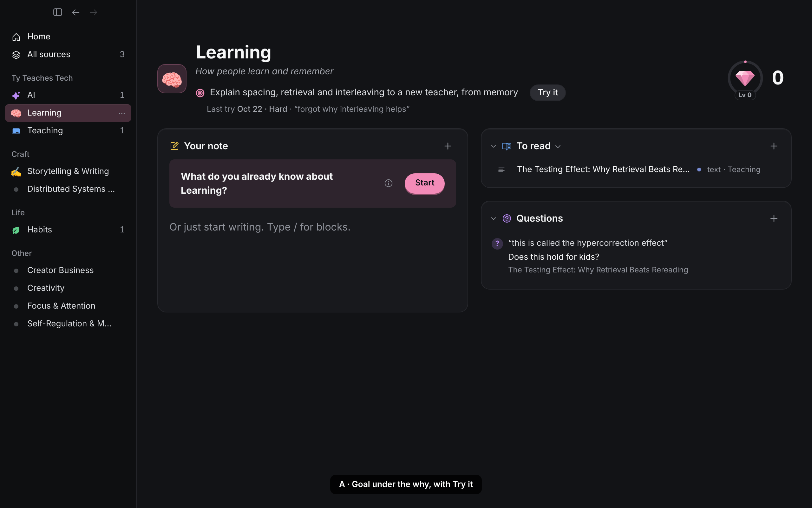
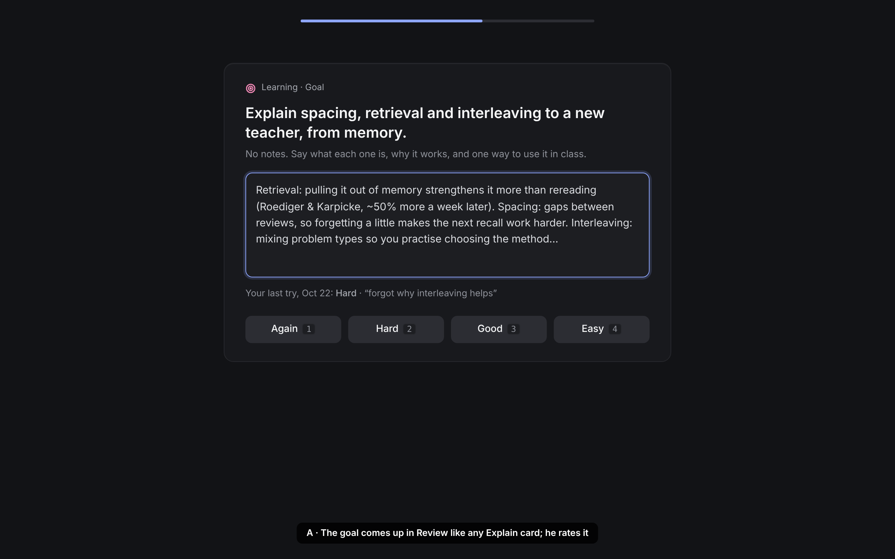
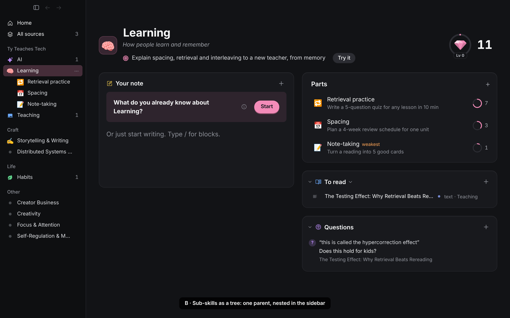
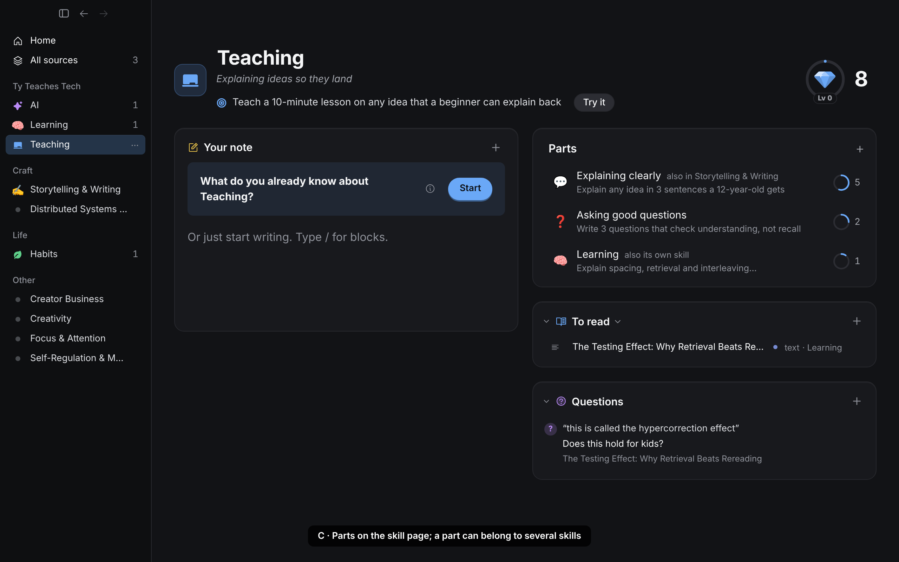
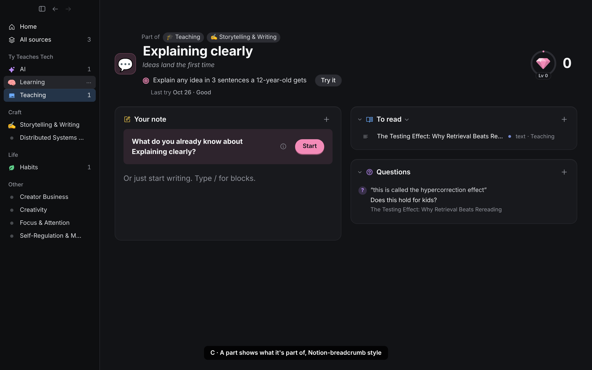

# Skill goals and parts (proposed, 2026-10-29)

Tyler, after an Alex Hormozi summary on learning fast: give each skill a goal (what mastery looks like), and let a skill break into sub-skills, or count toward several bigger skills. Status: after a stress test (`docs/reviews/2026-10-29-skill-goals-stress-test.md`), Tyler picked a smaller A, built as D102 (Try it uses the skill note's recall, no card). C is deferred. Hormozi's "ignore the why" is **not** adopted: Explain cards and elaboration stay (Dunlosky 2013; Chi 1994).

## What exists today

- A skill is flat: name, icon, colour, priority, one **collection** (sidebar grouping only, D36) and a **why** line (`hook`, D63).
- Sources and cards already belong to several skills; a card's retention is the max of its skills' priorities (D22).
- Strength is gems: cut (solid) memories, a ring to the next level (D63, D90). Review asks which skills to review (D80).
- Ruled out already: a graph view (D42), counts or badges for volume (D23, D62).

What's missing is a **target**: the gems say how much he remembers, nothing says what he is trying to be able to do, and nothing lets him see which part of a big skill is weak.

## The science, briefly

| Finding | Evidence | What it means here |
|---|---|---|
| Specific, hard goals beat "do your best" | Locke & Latham 2002 (≈1,000 studies) | A goal line he writes, concrete enough to try |
| For complex new skills, *learning* goals beat score goals | Winters & Latham 1996; Seijts & Latham 2001 | Phrase it as something he can show ("explain…", "write…"), never a number or a date |
| Near sub-goals raise mastery and self-efficacy more than a far goal alone | Bandura & Schunk 1981 | Parts, each with its own goal and ring, are the near goals |
| Tracking progress toward a goal helps (d ≈ .40), more when recorded | Harkin et al. 2016 | "Last try · rating" under the goal |
| Practise the actual target performance | Morris, Bransford & Franks 1977 (transfer-appropriate processing) | The goal itself is a card he attempts closed-book |
| Practise parts, but always also the whole task | Wightman & Lintern 1985; van Merriënboer 4C/ID | Parts' cards build pieces; the parent's goal card is the whole task |
| Deliberate practice: a defined task at the edge of ability, feedback, repetition | Ericsson et al. 1993 (Macnamara 2014: real but smaller than claimed) | Part rings show where he is weakest; the goal card gives repeated, rated attempts |
| Experts organise knowledge around principles that recur across domains | Chi, Feltovich & Glaser 1981; *How People Learn* 2000 | A part may serve several skills ("Explaining clearly" → Teaching and Writing) |
| People overrate what they can do | Dunlosky & Rawson 2012 | The check is a written attempt, never a "how confident are you" slider |

## Options

### A. A goal per skill (in every option below)

- Under the why: a target icon and one line, `goal` in `skills.yaml` (≤140 characters), edited in place like the why (Enter saves, Esc restores). Empty: "What could you show you can do?".
- Setting it makes **one Explain card** for the skill (credited "your goal"). FSRS schedules it; it comes up in Review like any card; he answers closed-book and rates it Again–Easy (D21; AI feedback as on other Explain cards, never the rating). Its last try shows under the goal.
- **Try it** attempts it now (an early review, as any card can have).
- Editing the goal retires the old card (its history stays) and makes a new one. Once it's a cut gem, the line under it reads "Solid · raise the bar?" (Locke & Latham: raise a goal once met).
- No percent, deadline or "goal met" badge. It counts as one gem like any card.

### B. Parts as a tree (one parent, nested in the sidebar)

- A skill can have one parent. The sidebar nests parts under it (a caret folds them, Notion pages / Finder folders).
- The parent's page gets **Parts** at the top of its right column: icon, name, the part's goal, its ring and cut count. The order is his (drag); + creates one in place.
- The parent's gems include its parts' cards (each card once). Picking the parent in Review includes its parts.
- Catch: one home only. "Explaining clearly" has to live under Teaching *or* Writing. And 3 parts × 9 skills is 27 more sidebar rows.

### C. Parts that can belong to several skills (recommended)

- A skill lists the skills it is **part of** (`part_of: [ids]` in `skills.yaml`, any number, no cycles, checked in `packages/core`).
- The parent's page has the same **Parts** card as B; a part shared with another skill says "also in Writing". An existing skill can be a part too (Learning as part of Teaching).
- A part's page shows **Part of** chips above its name (Notion's breadcrumb); a click opens that skill.
- The sidebar stays as it is: top-level skills by collection. Parts are reached from their parent's page, ⌘K and the skill picker. Picking a part from ⌘K selects its first parent in the sidebar.
- Gems and Review roll up as in B, each card counted once in every skill it reaches. Retention stays the max over a card's skills (D22); a new part takes its first parent's priority.
- Lifecycle: create in place from + on Parts (name field focused), rename inline, "Part of…" in the skill's ⋯ / right-click / ⌘K to add or drop parents (a checklist picker like Skills), drag to reorder Parts, delete with Undo (its cards keep their other skills).

## Recommendation

**A + C, built in that order.** A is small and gives every skill a target he practises, which is the strongest evidence here (specific learning goals + practising the target performance). C adds near goals and shows the weak part, and lets one part serve several skills, which is how skills actually overlap; it keeps the sidebar as calm as today. B's tree reads familiar but forces one home for shared skills and doubles the sidebar.

Not doing: a skill graph or map view (D42); a "weakest" label (the rings already show it; B's mock has one only to compare); AI creating parts on its own (D25). A later option, only if he asks: "Suggest parts" from the goal, as dashed chips he clicks to create (the `suggested_skill` pattern).

Would be D101 (goal) and D102 (parts) once picked.
