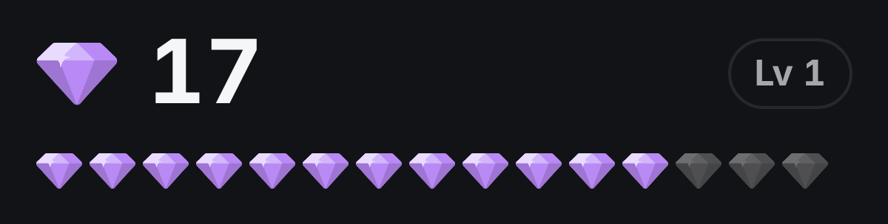
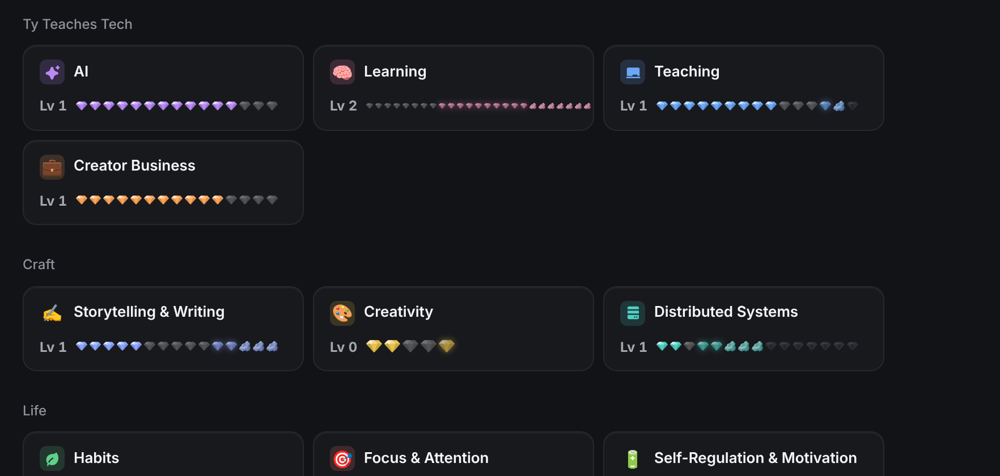
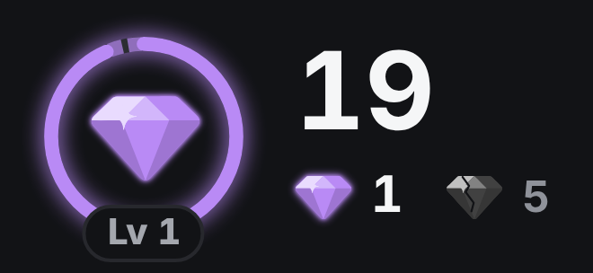
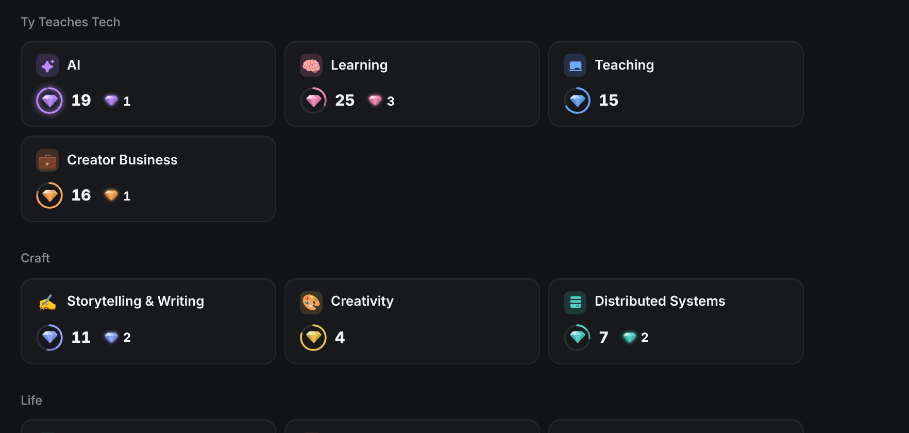
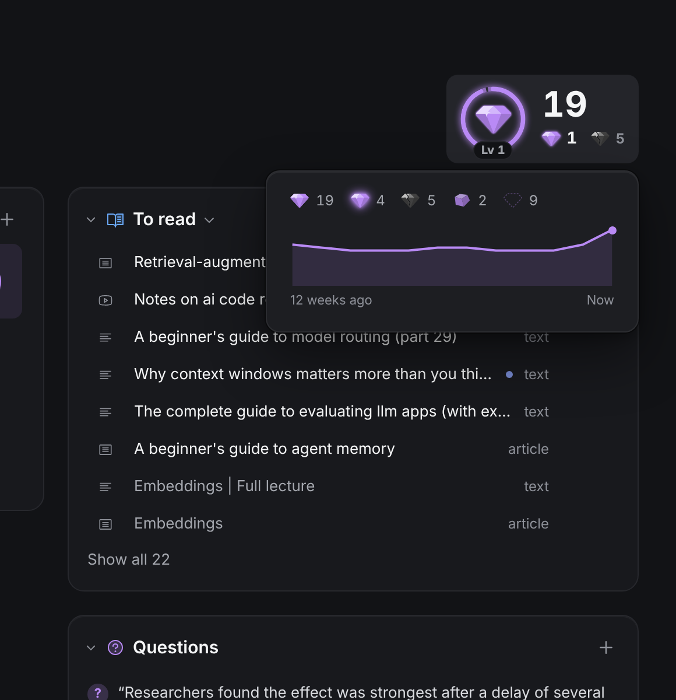
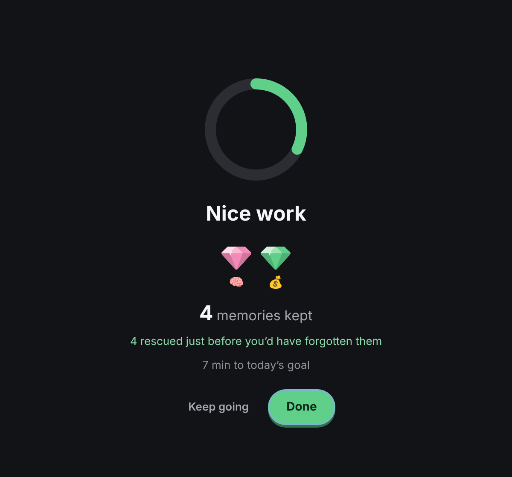

# Gems: PM-style review loop

> 2026-10-28. Tyler asked for an independent agent acting as a demanding PM to rate the gems design (D90) on five scales, 1 to 5, and for us to iterate (up to five rounds) until every scale is at least 4, thinking widely rather than incrementally. The reviewer saw only screenshots of the mocked app (`seed-big.ts`) and a short brief.

## Scales

1. **Readable at a glance**: a new user can tell cut, glowing, cracked and empty apart in 3 seconds, without hover.
2. **Honest**: reads as a true measure of memory, not points to farm.
3. **Pull of the near goal**: makes you want to review now.
4. **Delight and craft**: charm and polish at every size, from the Home tile to the end screen.
5. **Restraint**: adds meaning without noise, pressure or guilt (purpose rule, D23).

## Scores

| Round | Design | Glance | Honest | Near goal | Craft | Restraint |
| --- | --- | --- | --- | --- | --- | --- |
| 1 | Slot row: one gem per memory to the next level, "Lv" pill | 2 | 3 | 2 | 3 | 3 |
| 2 | Row tuned: outlined empty slots, cracked gems, glowing first, "Lv 2" goal at the end, gem legend | 3 | 4 | 3 | 3 | 4 |
| 3 | **New layout**: no row. The gem being cut in a ring to the next level, the count, glowing and cracked counts | 3 | 4 | 3 | 4 | 3 |
| 4 | Ghost arc for glowing cards, shimmer when they'd finish the level, "Lv N" pill, Home trimmed | 4 | 4 | 4 | 4 | 4 |
| 5 | Dashed ghost, "due today" meaning everywhere, ring glow, skill icons on the end screen | 4 | 5 | 4 | 4 | 4 |

After round 5 the ring only glows when today's due cards would finish the level, and the ghost is solid on small rings (the reviewer's last two notes).

## What changed direction

Round 2 showed the slot row itself was the limit: it mixed level progress with card states, a full row looked finished before the level was, and tiny states turned to specks at Home size. Round 3 replaced it with one object, the gem being cut (a ring), and moved card states to two small counts. The reviewer called it "clearly better ... it separates level progress from card states, can't look finished early, and scales from tile to header".

## Left for later

- The glowing gem as a one-click review of just those due cards (the reviewer's top remaining item; a new review mode, so it needs Tyler's call).
- The ghost arc is still subtle when only one card is due on a nearly full ring.

## Before and after

Round 1:  

Final:    
