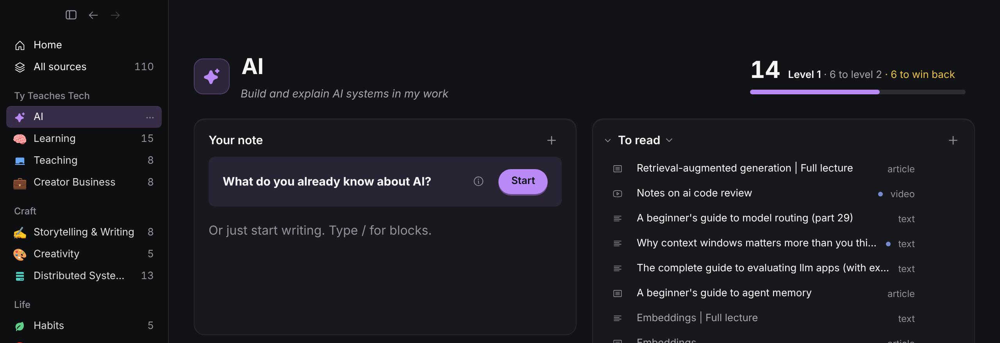
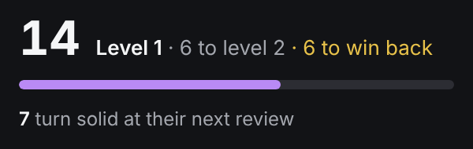
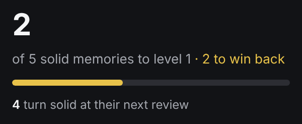
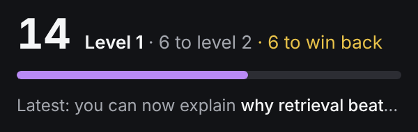
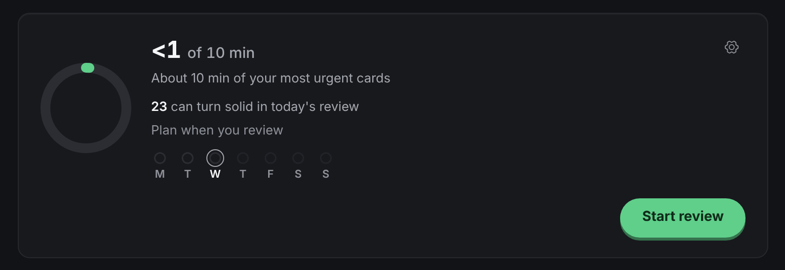
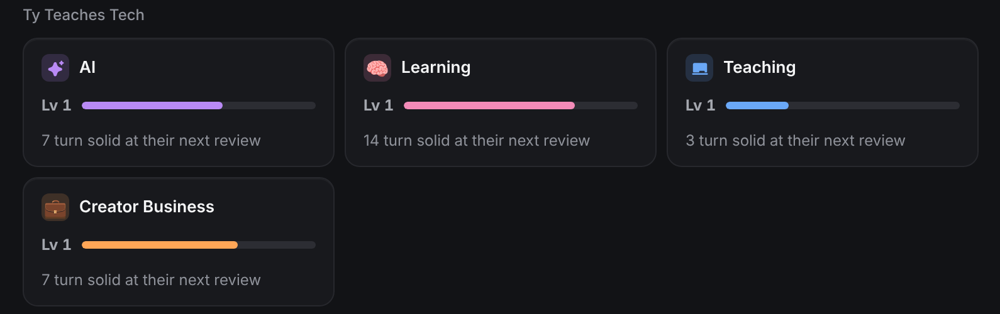
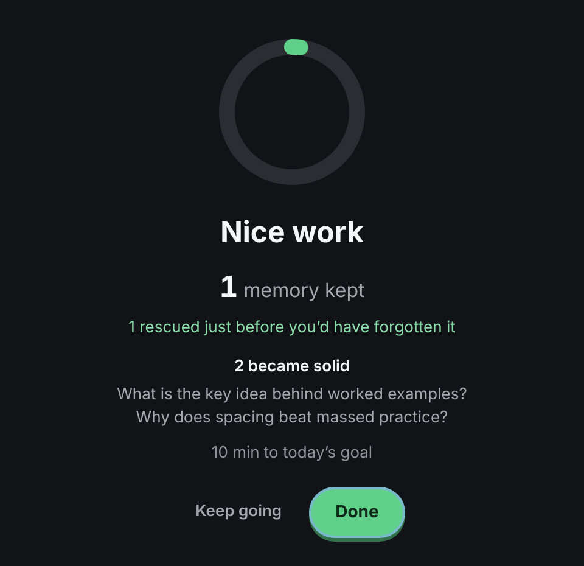

# Which skill numbers motivate, round 2

> Research, 2026-10-28. Builds on [`skill-strength.md`](skill-strength.md) (D62, D63) and the skill page header (D72). **Outcome:** Tyler went with gems instead of the lines below (D90): the near goal is a glowing stone ("ready") and the end of review drops in one cut gem per card that became solid; the Home Today line (2) was not built. Mockups are DOM edits on the mocked app (`seed-big.ts`, a year of use), shot at 2×.

Tyler asked which per-skill metrics we can track reliably that are proven, or strongly theorised, to motivate and give meaning, for the skill page's top right and maybe Home.

## Short answer

The headline is right and already built: **strength**, the count of solid memories (stability ≥ 21 days), with levels that never drop and "to win back" (D63, in the header since D72). Nothing in this round beats it, and it should stay the only number in the skill header.

What is missing is a **near goal**. A solid memory takes one to ten weeks to form, and levels sit 5, 20, 45, 80 solid apart, so for long stretches the number does not move. The best-supported fix is one line that names the next step, which FSRS can compute exactly:

1. **"7 turn solid at their next review"** under the skill header's meter (A). Proximal goals beat distal ones on effort, persistence and interest.
2. **"23 can turn solid in today's review"** as one line in Home's Today card (A). It gives today's review a reason that is about memory, not minutes.
3. **"2 became solid"** on the end screen of a review, naming the cards. This is where the win happens, so it is where the small win gets noticed.

All three are the same number seen at three moments: what's next for this skill, what today can do, and what just happened.

## What exists today

| Where | What it shows | Decision |
| --- | --- | --- |
| Skill page header, right | Solid count, "Level 1 · 6 to level 2 · 6 to win back", level meter; a click opens Solid/Growing/New, the 12-week growth line and "You can now explain" | D63, D72 |
| Skill page, under the name | His one-line "why" (the skill `hook`) | D63 |
| Home, Today | Goal ring (minutes), the slice line, the week dots, Start review | D58, D60, D65 |
| Home, skill tiles | Level and meter; before level 1, "N of 5 solid memories to level 1" | D58, D72 |
| End of review | Memories kept, rescued just in time, level-ups | D62 |
| End of the week's first session | Calibration: "When you say Sure, you're right N%" | D69 |

Tyler's screenshot of the AI skill shows an empty top right because that skill has no cards yet. That is D72's rule ("a skill with no cards yet shows no Strength") and it stays: a zero, or a made-up head start, has no purpose there, and the "What do you already know about AI?" card already says what to do first.

## The gap: nothing moves for weeks

A ts-fsrs run with the app's defaults (`packages/core/src/scheduler.ts`), one new card, every answer Good:

| Priority (retention) | Reviews to solid | Days to solid | With one miss |
| --- | --- | --- | --- |
| P1 (0.92) | 3 | 10 | 18 days, 6 reviews |
| P2 (0.88) | 3 | 21 | 41 days, 6 reviews |
| P3 (0.80) | 2 | 8 | 73 days, 5 reviews |

So a new skill reads "0 of 5 solid memories to level 1" for one to six weeks, and later levels need 15, 25, then 35 more solid memories. In the big demo library, after a year of use, no skill is past level 1 (10 at level 1, 4 still at 0). Strength is the right *distal* measure; it needs a *proximal* one beside it.

## Evidence

| Finding | Strength of evidence | What it means here |
| --- | --- | --- |
| Proximal subgoals vs a distal goal: 74% vs 55% of the work done, persistence on hard problems +90% vs +22%, ~90% vs ~40% chose the task in free time, self-efficacy judgments more accurate (80% vs 54%) [1] | Classic RCT, small (N = 40 children); widely replicated in goal-setting work | Pair the distal level with the next concrete step: "7 turn solid at their next review" |
| Monitoring progress toward a goal raises attainment, d ≈ 0.40; larger when progress is recorded or made visible [2] | Meta-analysis, 138 studies, N ≈ 19,951 | Show progress where he decides to act (skill page, Home), not only in a popover |
| Goal gradient: effort rises as the goal gets near [3]; motivation sags in the middle [4] | Field data + lab studies | A line about the *next* step stays "near" through every level's long middle |
| Positive, informational feedback raises intrinsic motivation; expected tangible rewards lower it (d = −.40) [5] | Meta-analysis, 128 experiments | Say what his memory did ("became solid"), never pay him for it (no unlocks, no points) |
| Gamification barely moves felt competence unless feedback tracks real skill [6][7] | Two meta-analyses | Every new number counts FSRS memory, not cards seen, minutes or sources |
| Measuring an activity can make it feel like work [8] | 6 experiments | Nothing during a card. Lines show before (Home, skill page) and after (end screen) |
| The best days are the ones with visible progress on meaningful work; small wins count if they are noticed [9] | 11,637 diary entries (correlational) | Name the cards that became solid, in his own questions |
| Duolingo: a milestone moment raised day-7 retention by 1.7%; loss aversion grows with streak length and makes people avoid challenges; reaching a 7-day streak goes with 3.6× course completion (not causal) [10] | Company A/B tests and survey | Celebrate the milestone (we do, on level-up). Keep D23's no-streaks: the gains are in app use, and loss aversion pulls against hard cards |
| Feedback framed by your own past (temporal) vs others (social) works best when it fits what the learner prefers [11] | 2 experiments, N = 335 | Self-comparison stays the default; social stays later and private (D62) |

## Candidates, scored

Each candidate must pass three tests: computable exactly from the library, backed by the evidence above, and with a one-line purpose (AGENTS.md purpose rule).

| Candidate | Data | Evidence | Purpose | Verdict |
| --- | --- | --- | --- | --- |
| **Turn solid at next review** | Exact: ts-fsrs `nextState(card, due, Good)` ≥ 21 d | Proximal goals [1], goal gradient [3] | Shows the next step toward strength | **Skill header (A)** |
| **Can turn solid today** | Same, for cards in today's slice | Proximal goals [1], monitoring [2] | A memory reason to review today | **Home Today (A)** |
| **Became solid this session**, named | Exact: stability crossed 21 d in this session's reviews | Informational feedback [5], small wins [9] | Makes the win visible when it happens | **End screen** |
| Latest "You can now explain" in the header | Exact (already in the popover) | Progress principle [9] | Concrete competence | Option B; truncates, repeats the popover |
| Date of the next level ("Level 2 by Dec 3") | Forecast from recent pace | None direct; small-n forecasts swing | Weak; moves with every miss | No |
| Weeks active / streak | Exact | Duolingo [10] gains are app use, not learning; loss aversion | Habit, already served by the week dots and reminder (D67) | No (D23) |
| Questions answered | Exact (D75) | Self-set goals (self-concordance, D63) | Already a list in the skill's Questions panel | No new number |
| Sources finished, minutes, cards reviewed | Exact | Volume (D62); overjustification [5] | Fails | No (D72 removed them) |
| Recall chance now, retention % | Exact | Decays while away; flat under FSRS | Fails | No (D63) |
| AI-graded "coverage of the skill" | AI estimate | None; unreliable | Unclear | No |

## Skill page, top right

The header keeps one number. The pick is which second line goes under the meter.

**Now**

**A. Next to turn solid (recommended)**

- Says what the next review will do for this skill. During the weeks where the big number stands still, this line moves.
- Bold count, muted words, same 12 px as the hint style. Hidden at 0 (nothing would turn solid next time).
- The hover hint explains: "Cards that become solid memories if you recall them next time."

**B. Latest win**

- Shows his newest solid Explain card in the header. Meaningful, but it truncates at 300 px, repeats the popover's list and says nothing about what to do next.

## Home

**A. One line in Today (recommended)**

- One line, at the moment he decides whether to start. It turns "10 minutes" into "23 memories that can become solid".
- Hidden at 0. Counts only cards in today's slice (D65), so it never pushes past the goal.

**B. A line on every skill tile**

- The same line fourteen times. Each is accurate, but together they are a wall of numbers that fails the purpose rule; the skill page already says it per skill.

## End of review

- "2 became solid" and their questions, under "rescued". Nothing when none did. No A/B: it is the one place the win happens, and it already has a "kept" line for volume-free feedback.

## Guardrails (unchanged from D62, D63)

- Never during a card. No sounds, unlocks or points for any of these.
- The new lines are conditional on recall, so the copy says "if you recall them" in the hint and never promises.
- Skills are never ranked by any of these.
- Nothing for a skill with no reviewed cards.

## Open for Tyler

1. Skill header: **A** (next to turn solid) or **B** (latest win)?
2. Home: **A** (one Today line) or **B** (every tile)?
3. End screen "became solid": yes or no?

Would be D90 once picked.

## References

1. [Bandura & Schunk 1981, Cultivating competence, self-efficacy, and intrinsic interest through proximal self-motivation](https://uploads-ssl.webflow.com/59faaf5b01b9500001e95457/5bc552d85141987915dab842_Bandura%20&%20Schunk,%201981.pdf), JPSP 41(3).
2. [Harkin et al. 2016, Does monitoring goal progress promote goal attainment? A meta-analysis](https://eprints.whiterose.ac.uk/91437/), Psychological Bulletin 142(2).
3. Kivetz, Urminsky & Zheng 2006, The Goal-Gradient Hypothesis Resurrected, JMR (see [`skill-strength.md`](skill-strength.md) [5]).
4. Bonezzi, Brendl & De Angelis 2011, Stuck in the Middle, Psychological Science (see [`skill-strength.md`](skill-strength.md) [7]).
5. Deci, Koestner & Ryan 1999, A meta-analytic review of experiments examining the effects of extrinsic rewards on intrinsic motivation, Psychological Bulletin 125(6).
6. Sailer & Homner 2019, The Gamification of Learning: a Meta-analysis, Educational Psychology Review (see [`skill-strength.md`](skill-strength.md) [1]).
7. Li et al. 2024, Gamification enhances intrinsic motivation, autonomy and relatedness, but minimal impact on competency, ETR&D (see [`skill-strength.md`](skill-strength.md) [2]).
8. Etkin 2016, The Hidden Cost of Personal Quantification, JCR (see [`skill-strength.md`](skill-strength.md) [4]).
9. Amabile & Kramer 2011, The Progress Principle (see [`skill-strength.md`](skill-strength.md) [12]).
10. [Duolingo blog, streak research (Mansur, 2024)](https://blog.duolingo.com/duolingo-streak-research/); [How streaks keep Duolingo learners committed](https://making.duolingo.com/how-streaks-keep-duolingo-learners-committed-to-their-language-goals).
11. [Compared to what? Effects of social and temporal comparison standards of feedback in an e-learning context, 2022](https://doaj.org/article/94330a77400742be827f69390fdbb647), IJETHE.
