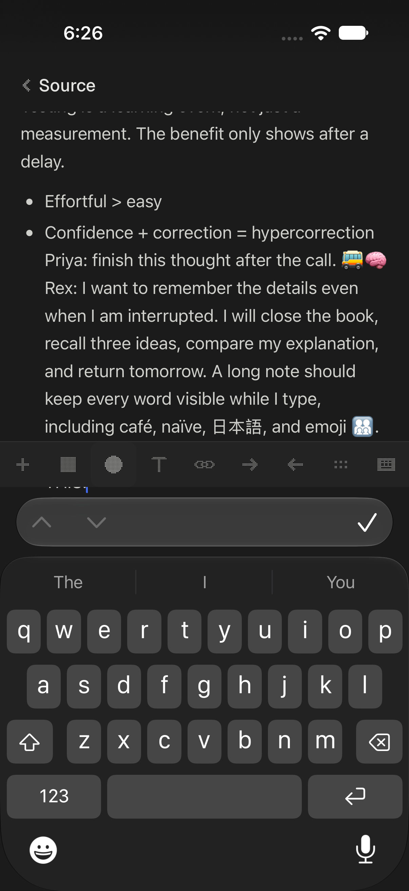
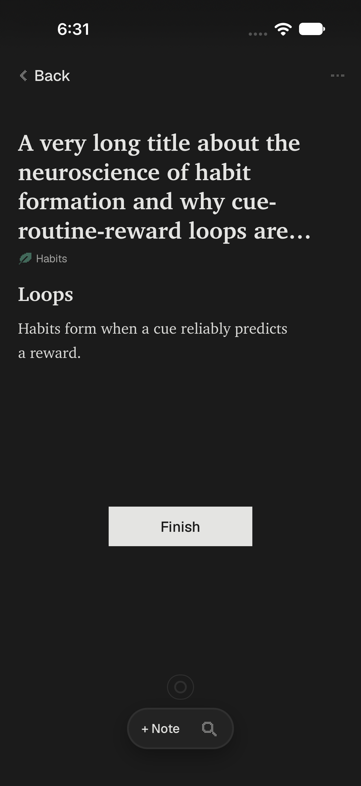

# Ore iPhone: native Simulator usability audit

## Summary

1. **Major — The source-note toolbar covers the current line and insertion point while typing a long note.** Reproduced twice; manual scrolling reveals the text.
2. **Minor — Opening a source still truncates its long title, and tapping the title does not expand it.** Reproduced on reopening; the full title is available indirectly in Finish.

No blocker or confirmed loss of saved work was observed. Archive Undo was attempted but remains inconclusive because the screenshot-inspection delay could outlast the toast.

## Setup and evidence

Tested the supplied, already-installed Ore app in the iPhone 18 Pro Simulator, at **402 × 874 points**, in dark appearance. Native touches went through `apps/phone/scripts/sim.ts` and XCUITest. Each action's screenshot was opened before choosing the next action. Screenshots here are unchanged **1206 × 2622 PNGs**, copied from the driver's output. The session ran on November 11, 2026, Pacific time; this report uses the requested November 12 folder name.

Maya and Sam used the initial scratch library. The driver's `reset` restored the scratch app before Priya; Rex continued from Priya's state. No source code, real library, or iCloud files were changed. The installed app was not rebuilt, and its correspondence to the working checkout was not established. Existing and concurrently appearing source edits in the checkout are outside this audit.

Apple Notes, Mail and Books supply the interaction expectations below; this session did not run a separate comparative audit of those apps. Findings describe visible behavior, not an inferred implementation cause.

## Findings

### 1. The note toolbar hides the line being typed

- **Severity:** major
- **Who:** Rex, continuing Priya's unfinished note
- **Screen:** full-screen source note for “The Testing Effect: Why Retrieval Beats Rereading,” with the software keyboard open
- **Person's cost:** the person must stop typing and manually scroll to inspect the words just entered. The toolbar hides both text and most of the insertion point, making corrections difficult.

**Expected:** keep the insertion point and current line above both the formatting toolbar and keyboard, as in Apple Notes. Continuing to type should keep the current line readable without a separate scroll.

**Observed:** the editor scrolled as the note grew, but its final lines landed underneath the fixed formatting toolbar. The insertion point protruded below that bar while the line itself was obscured. A direct tap on the keyboard's `t` key also left the line hidden. Scrolling the note upward revealed the ending, including the typed `t`: this is an obstruction, not demonstrated data loss.

**Exact reproduction commands used:** run each command from the repo root and inspect its screenshot before continuing. Starting state: Today after Priya left her review, with Continue reading at approximately `(190, 370)`; the source's seeded note contains “Big idea” and the two existing bullets. Coordinates depend on that fixture and state.

```bash
bun apps/phone/scripts/sim.ts tap 190 370
bun apps/phone/scripts/sim.ts swipe 200 720 200 320 0.4
bun apps/phone/scripts/sim.ts launch
bun apps/phone/scripts/sim.ts swipe 400 400 80 400 0.4
bun apps/phone/scripts/sim.ts tap 375 330
bun apps/phone/scripts/sim.ts type " Priya: finish this thought after the call."
bun apps/phone/scripts/sim.ts launch
bun apps/phone/scripts/sim.ts tap 327 357
bun apps/phone/scripts/sim.ts type " 🚌🧠 Rex: I want to remember the details even when I am interrupted. I will close the book, recall three ideas, compare my explanation, and return tomorrow. A long note should keep every word visible while I type, including café, naïve, 日本語, and emoji 👨‍👩‍👧‍👦. This is the last sentence of my note: KEEP THIS."
bun apps/phone/scripts/sim.ts shot
```

The extra `shot` captures the settled software keyboard, rather than the transient keyboard state immediately after the driver's `type` action.



**Second try: reproduced.** First, a real keyboard tap left the obstruction in place; manual scrolling revealed the first ending. Appending another paragraph brought the ending underneath the toolbar again.

```bash
bun apps/phone/scripts/sim.ts tap 180 620
bun apps/phone/scripts/sim.ts swipe 355 395 355 210 0.4
bun apps/phone/scripts/sim.ts type " Second try: I am adding another thought about memory. Practice should require effort, but it should not turn into guessing randomly. I need to check my answer after I recall it. Tomorrow I will use a different example, explain the idea to a friend, and see which details I still remember. SECOND END."
bun apps/phone/scripts/sim.ts shot
```

Evidence: [keyboard tap still obscured](shots/note-keypress.png), [manual-scroll recovery](shots/note-recovered.png), and [second occurrence](shots/note-covered-again.png). The second occurrence hides the line ending in `SECOND END.`

### 2. The source detail view cuts off a long title

- **Severity:** minor
- **Who:** Rex
- **Screen:** reader for the habit-formation fixture
- **Person's cost:** opening the truncated list item still does not reveal its full name; the ending contains part of the title's meaning.

**Expected:** truncation in a compact list is reasonable, but the opened item should expose its complete title through wrapping or an obvious expansion. Apple Mail's message-detail subject is the relevant expectation: opening an item gives room to read what the list shortened.

**Observed:** the title occupies four lines and ends `routine-reward loops are…`. Tapping it does nothing visible. The full ending, `harder to break than to build`, appears in the Finish recall sheet after dismissing the keyboard. That is a recovery path, but it requires entering an unrelated workflow.

**Exact reproduction commands used:** starting in Sources after the prior persona's navigation, with the habit-formation source at `(200, 330)`:

```bash
bun apps/phone/scripts/sim.ts doubletap 200 330
bun apps/phone/scripts/sim.ts tap 200 225
bun apps/phone/scripts/sim.ts doubletap 200 585
bun apps/phone/scripts/sim.ts tap 360 512
```

The first command opens the source once; the second tests expanding the title. The last two enter Finish and dismiss the keyboard, exposing the full title.

Evidence: [title after tapping it](shots/title-tap.png), [complete title in Finish](shots/title-in-finish.png).

**Second try: reproduced.** Closing Finish and reopening the same source still truncated the title. The source had moved to the first row in the current Sources ordering.

```bash
bun apps/phone/scripts/sim.ts tap 341 113
bun apps/phone/scripts/sim.ts tap 45 84
bun apps/phone/scripts/sim.ts tap 200 242
```



## The four people

### Maya — ten minutes on the bus

Maya completed five exercises, returned through Continue reading, selected two passages with native selection handles, saved one ordinary highlight and one Key point, added a short highlight note, and finished the source through its recall and question flow. Selection actions appeared immediately, the [highlight note remained visible](shots/highlight-note.png), and review explicitly said [answer checking runs on the Mac](shots/review-mac-message.png) instead of failing. The hardest part was managing the keyboard during Finish: she dismissed it or scrolled to reach the next controls, but reached [the finished-source state](shots/source-finished.png).

### Sam — tidying up

Sam searched for `fluency`, a word from the source's middle; the result opened [at the matching passage](shots/body-search.png), and right swipes moved Building Effective Agents to Done and back to To read. He archived sources by left swipe, attempted Undo twice, then restored the archived sources from Archive until its [empty state](shots/archive-empty.png), and wrote a Learning skill note that [survived closing and reopening](shots/skill-note.png). Undo was the hardest part: neither attempt restored the row, but the delay between viewing the toast and tapping prevents attributing that result to a broken control.

### Priya — interrupted

Priya rated one exercise, went Home during the next exercise, and returned to the same question and progress. She then relaunched while reading and while writing a source note: [reading before](shots/reading-before.png) versus [after relaunch](shots/reading-restored.png) retained the visible passage and scroll position, and [note before](shots/note-before.png) versus [after relaunch](shots/note-restored.png) retained her sentence and the note screen. Neither interruption produced a visible loss of place or work; the later difficulty arose when Rex extended that note until its current line was covered.

### Rex — clumsy thumbs

Rex tried edge misses, short edge and row swipes, mostly vertical row swipes, long-press menus, double taps on a row and Finish, rapid double taps on review ratings and Check, rotation, and long notes and answers containing accents, Japanese and emoji. Short swipes stayed on the current screen, vertical swipes did not archive a row, double taps produced one visible navigation or exercise advance, and the [long answer](shots/long-answer.png) survived [Home and return](shots/answer-restored.png); its comparison field could be scrolled to reveal [the final sentence](shots/answer-end.png). The hardest parts were the covered note line and the truncated source title; requesting landscape left the app visibly [in portrait](shots/rotation.png).

## Coverage and limits

| Area | Observed result / limit |
| --- | --- |
| Today review → completion → reading | Completed Maya's full loop. |
| Review without phone AI grading | Clear Mac-only checking explanation; manual rating remained available. |
| Native selection, highlight, Key point, highlight note | Completed with long press and selection-handle drags. |
| Source Finish | Completed recall, questions and final confirmation. |
| Search by body text | `fluency` returned the source and opened the matching text with an in-source match indicator. |
| Drawer and pull-down search | Both exercised. |
| To read ⇄ Done | Right swipe moved the source both ways. |
| Archive and restore | Left swipe archived; left swipe in Archive restored. |
| Archive Undo | **Inconclusive.** Two Sam attempts and a later retry did not restore the row. The first documented pair of screenshots was seven seconds apart; the later pair was sixteen seconds apart. The toast could expire during the required screenshot inspection. See [toast](shots/archive-toast.png) and [late tap result](shots/undo-late.png). This is not counted as a confirmed app finding. |
| Skill note | Written, closed, reopened; text retained. |
| Background review / answer draft | Same question and progress returned; a long unsubmitted answer also survived Home/activate. |
| Relaunch during reading and note editing | Reading position, note screen and note sentence retained. |
| Edge gestures | Full left-edge swipe returned; short left-edge swipe stayed. Right-edge swipe opened the source note. |
| Clumsy row gestures | Short horizontal and mostly vertical swipes did not archive. The six-source list fit on screen, so sustained scrolling of a long list was not tested. |
| Repeated taps | One visible navigation on row/Finish; one exercise advance per tested double rating tap. Double Check did not skip to a new exercise. These observations do not prove absence of duplicate internal writes. |
| Rotation | `rotate landscape`, then `rotate portrait`, left the app in portrait. No landscape layout could be inspected. |

The following were not covered:

- Adding sources, AI features and sync, as explicitly excluded. Only the phone's explanation of unavailable grading was checked.
- A physical device, haptics, actual bus use, lock-screen/phone-call interruptions, or operating-system memory pressure. Home/activate and the driver's quit/relaunch were the interruption mechanisms.
- Reliable animation smoothness or end-to-end response timing. Discrete screenshots sometimes caught keyboard and activation transitions; a settled screenshot was checked before treating those states as defects.
- Light appearance, larger accessibility text, VoiceOver, other device sizes, a large library, or many overlapping highlights. The supplied scratch fixture and appearance were used.
- Review “go again” after the final completion screen, review recovery after a forced quit, and every item in every source menu. These are coverage gaps, not passes.

Only the two findings above were reproduced sufficiently to include as app defects. No code fixes or implementation diagnoses are part of this report.
