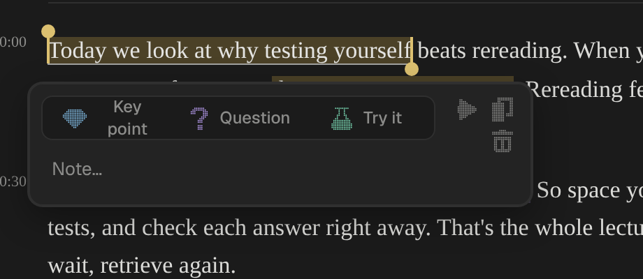
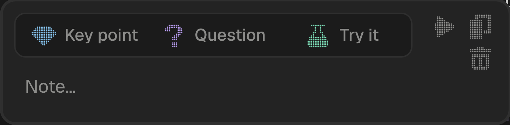

# Impeccable critique, round 7: Ore desktop, with a first look at the iPhone (2026-11-14)

Method: dual-agent (A: design review on the mock app, 1280×800 at 2×, plus Home at 900×700 and 1600×1000, and the
iPhone build at 390×844 with touch; B: `impeccable detect`, the CI gate, `style-check.ts` and the browser overlay on
six Mac views and the phone's Today), on master at 194b807 (#389). Review and its end screen were shot on the demo
library (`seed-demo.ts`: a standing backlog, nine of the day's ten minutes done), as round 6 asked.
**Score: 30/40, up 1 from round 6 (29).** Trend: 26 → 28 → 30 → 30 → 28 → 29 → 30.

Detector: 11 counted findings, all in the CI baseline (Geist `@font-face` and font names ×8, three blockquote-style
left rules; round 6 counted 10, the eighth Geist line is Settings' font preview and is baselined). 167 advisory
(152 in round 6): colour literals 119, radius 28, the spring token and its uses 11, off-ramp sizes 9.
`impeccable-gate.ts`: no new findings. `style-check.ts`: clean. Overlay: one finding per view, Geist as the main
font (chosen, D129); Settings adds "cramped padding" on `.settings-sheet`, a false positive (it is a clipping shell
with no padding of its own, its one child fills it).

| # | Heuristic | Score | Round 6 | Key issue |
|---|---|---|---|---|
| 1 | Visibility of system status | 3 | 3 | The memory line over the ratings says what it is only on hover |
| 2 | Match with the real world | 3 | 3 | "TEXT" kind label, "Lv 0", "No prequestions yet", the target glyph before the skill subtitle |
| 3 | User control and freedom | 3 | 3 | Esc from Review now lands on the end screen with Keep going / Done; a second Esc in the reader drops to Home with no cue |
| 4 | Consistency and standards | 3 | 2 | The sidebar is one pixel icon set now (D157). Left: To read is a named tab while Done is a bare check; a key footer in Review, hover hints elsewhere |
| 5 | Error prevention | 3 | 3 | Check sits dimmed until a confidence is picked, with no words saying why |
| 6 | Recognition rather than recall | 3 | 3 | Icon-only clusters: four tools under the ratings, the popup's tools, five ambience channels, two gem counts per skill |
| 7 | Flexibility and efficiency | 4 | 4 | Nothing worth raising: ⌘R, ↵, 1–3, ↵ runs a session |
| 8 | Aesthetic and minimalist design | 3 | 3 | ⌘K opens with five "Play Cave / Rain / Lamp…" rows in its first nine |
| 9 | Error recovery | 3 | 3 | "Couldn't check this one… try again" is right; a failed check suggests no rating, so ↵ does nothing |
| 10 | Help and documentation | 2 | 2 | Every explanation is a hover: what Key point, Question and Try it each do, the gems, the memory line |

Design-specificity: authored. The dot ring, the cut gems, the mole with one line of speech, the amber radio, the
source dissolving into dots while he recalls, and copy like "Cut: you'd still recall this three weeks from now"
belong to Ore alone. One drawing language now holds across the sidebar, Home, the picker, the end screen and the
phone. Settings and the sources list are deliberate copies.

Cognitive load: 2 of 8 fail (moderate, low end; 3 in round 6): minimal choices and working memory. Decision points
over four options: Review's check step (4 ratings + 4 tools + Open in source), the highlight popup (3 types + 3 to 5
tools + the note), ⌘K's opening list (9, unchunked).

Emotional journey: the peak is the strip after an answer ("+49 days… you still had it"), which lands with the next
exercise already up. The end screen at nine of ten minutes with a backlog reads as a win, not a debt. The valley is
a typed answer whose check fails: three unticked points and four ratings with none suggested.

## Fixed in this PR
- **The highlight popup on a recording**: "Key point" wrapped onto two lines and spilled out of its button, because
  Play adds a second column of tools. The names no longer wrap.
  
  
- The same Play button was named "Play the video from here" on a podcast or lecture. Now "Play from here".
- The memory line said "next in 1 months".
- Settings › New exercises a day showed nothing picked when the library's value was off the list (Mac and iPhone).
- The Shortcuts sheet listed ⌘1, ⌘2, two other rows, then ⌘0, ⌘3; and still listed "Save main point ↵" (F81).

## What the review raised, and what held up
- **The mole button covers the last skill's gem count at 900×700** (P3 as raised). Not a defect: Home keeps
  `--mole-room` under its last row; the shot was taken mid-list.
- **Nothing says what Key point, Question and Try it do.** Half wrong: each has a hover line (`MEANS` in the reader).
  It stays the Help row's key issue because hover is the only place.
- **On every show exercise in the demo, the answer and the source's quote are the same sentence.** The demo seed
  writes them so. Whether real exercises do is for a look at the real library, not this pass.
- **The crash screen prints the raw exception.** Seen only in the phone preview in a browser, which has no Tauri.
  One user who reports bugs by pasting them: the raw line is the useful one.

## Tyler's picks (2026-11-14), built in the same PR
1. Review names Retire in its key bar, and the memory line ends with "next in 1 month" (F127).
2. What to review with its gem numbers in words: mocked for him on the Mac and the iPhone, and declined: words there are prone to overflowing. D249 stands, words on hover (F128).
3. ⌘K lists an ambience channel only once he types (F129).
4. iPhone Review: how sure he is and the ratings sit at the foot of the screen; what the last answer won stands above them (F130).
5. End screen: the mole never says a number the row under the ring already shows (F131, Mac and iPhone).
6. iPhone skill page: a question takes two lines (F132).

The iPhone scored about 27/40 on thinner evidence, apart from the score above; its ⋯ sheet did not open under automation.

## Round 6's open items
Fixed: emoji beside pixel icons in the sidebar; four hover hints at once when tabbing Home; the end screen with a
backlog is shot; Continue reading at 1600 wide. Still there: hints in two forms; "TEXT"; "Lv 0" on a new skill; the
flask row on the end screen with no word (cut with an ellipsis on the phone); the What to review stop before the
first exercise.

## Persona notes
- Alex (power user): happy. Tab from the sidebar reaches + Add, the mole and the radio before Start review.
- Jordan (first-timer): "Lv 0", "TEXT", "prequestions", three popup types whose difference is a hover away.
- Tyler (keyboard first, standing backlog, 10 min a day): well served; the one valley is the failed check.

## Questions the review left
- If the picker's default is everything, why does he see it every day and not only when he holds a modifier?
- When a check fails, could the points he ticks by hand produce the suggested rating, so ↵ still works?
