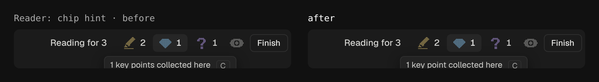
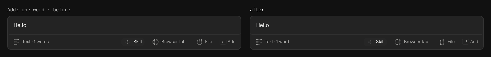
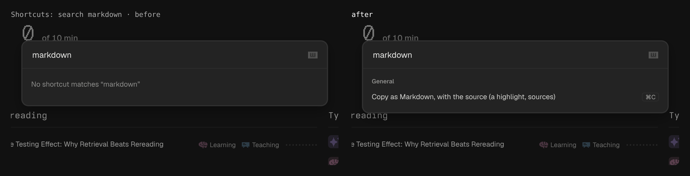
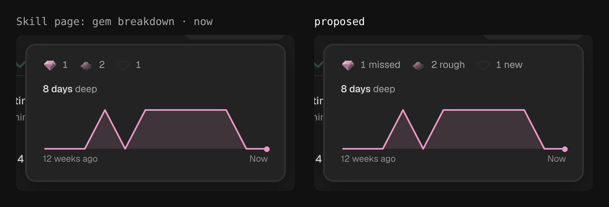
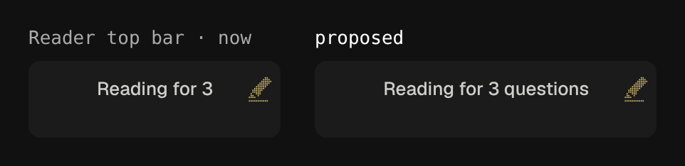
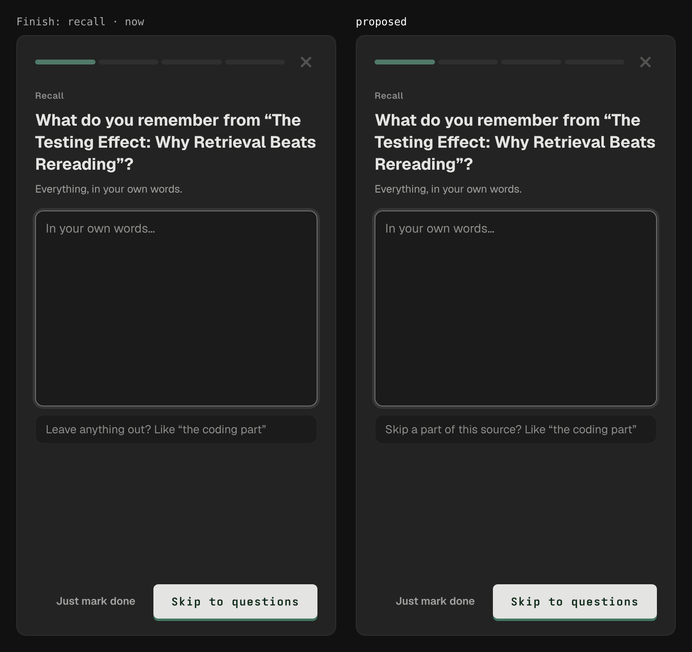
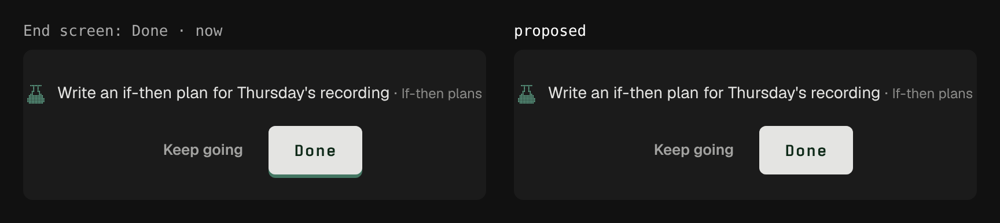

# Impeccable critique, round 8: Ore desktop (2026-11-14)

Method: dual-agent (A: design review on the mock app at 1280×800, the seeded library and, for Review and its end
screen, the demo library; B: `impeccable detect`, the CI gate, `style-check.ts`, the browser overlay on nine views
and a mechanical pass for names, hints, `title=`, disabled controls, plurals and empty states), on master at
52d7a3a (#404). The brief led with the two rows that have been weakest for seven rounds: Consistency and Help.
**Score: 30/40, level with round 7.** Trend: 26 → 28 → 30 → 30 → 28 → 29 → 30 → 30.

Detector: 11 counted findings, all in the CI baseline (as round 7). 170 advisory (167): three more colour literals,
from the end screen's ring (#402). `impeccable-gate.ts`: no new findings. `style-check.ts`: clean. Overlay: Geist as
the main font on every view (chosen, D129), "cramped padding" on the Settings shell (false, as before), and the
highlight popup "covering" the paragraph it was opened on (false: it floats under the selection). No interactive
element without a name and no icon-only button without a hover line, on any of the nine views.

| # | Heuristic | Score | Round 7 | Key issue |
|---|---|---|---|---|
| 1 | Visibility of system status | 3 | 3 | The memory line over the ratings says what it is only on hover |
| 2 | Match with the real world | 3 | 3 | "Reading for 3" never says three of what; "TEXT", "Lv 0" |
| 3 | User control and freedom | 3 | 3 | Esc in the reader leaves the source when he meant to close something smaller |
| 4 | Consistency and standards | 3 | 3 | Counts of one in the plural; the paper button drawn flat in some places, with a green lip in others |
| 5 | Error prevention | 3 | 3 | Better: Check with no confidence picked turns "How sure are you?" orange. Left: in the popup, the eraser (removes source text) sits over the trash (removes the highlight), both icon-only |
| 6 | Recognition rather than recall | 3 | 3 | The skill's gem breakdown is three icons and three numbers |
| 7 | Flexibility and efficiency | 4 | 4 | Nothing worth raising |
| 8 | Aesthetic and minimalist design | 3 | 3 | ⌘K opens on 17 commands in one group |
| 9 | Error recovery | 3 | 3 | A failed check still suggests no rating |
| 10 | Help and documentation | 2 | 2 | Meanings are a hover away: the three highlight types, the gems, importance; two labels mislead |

Design-specificity: authored, as round 7. Cognitive load: 2 of 8 fail (minimal choices, working memory), the same
decision points as round 7.

## Fixed in this PR
- **One of a thing was plural in six places.** The reader's chips said "1 key points collected here" (F-new-one-questions);
  Add said "Text · 1 words" and "Course · 1 lessons"; a drop of one file said "Added 1 sources", and of one already
  there "All 1 are already here"; a one-lesson course said "Added 1 lessons"; Home's week read "of 1 days" to a
  screen reader (F-new-one-sources).
  
  
- **Searching the Shortcuts sheet for "markdown" found nothing**, though every menu calls ⌘C "Copy as Markdown": the
  sheet's row said only "Copy with the source". It now carries both names (F-new-copy-names).
  
- Add's field said "a link, a file, or any text"; the empty lists that point at it say "a link, a file or any text".
  One wording (F-new-add-comma).
- A new guard: no control explains itself with the system's `title=` (`hints.test.ts`). The two that keep one are
  listed with the reason (the icon grid's 205 cells, a transcript's timestamps: a `<Hint>` each would cost speed).

## Raised with Tyler: each bends a settled rule, mocked, nothing built
1. **Skill page, gem breakdown** (D90 keeps words on hover): a word after each count. He opens this to understand
   the gems, and it has the room that What to review (D249) did not. 
2. **Reader, "Reading for 3"** (D179): "Reading for 3 questions". 
3. **Finish, "Leave anything out?"** (D100): under the recall box it reads as a question about his recall; it tells
   the AI which part of the source to skip. "Skip a part of this source?". 
4. **The paper button's green lip** on Check, Save, Done and Skip to questions. `DESIGN.md` gives the lip to answer
   buttons only and calls the primary flat, as it is on Home, the picker and Feed; the lip survives through two
   older rules that outrank `retro.css`. Flat everywhere, or the lip written into `DESIGN.md`. 

## What the review raised, and what held up
- **"Search sources" on a skill page, "Filter sources" on All sources.** Two controls: the section search (D203) and
  the list's filter; ⌘F on a skill page opens Find on the page (D81), so the magnifier rightly shows no key.
- **"Bring back" a skill, "Restore" a source.** D173 names Bring back. Left; one word would be simpler.
- **"Try it" on the popup, "To try" over its list.** One is the act, the other the pile. Left.
- **"Delete skill…" with an ellipsis, the other deletes without.** Right: only the skill asks first.
- **A typed exercise's key bar lists no key for how sure.** By design (round 6).
- **Empty searches come in six wordings** ("No matches", "Nothing in To read matches…", "No shortcut matches…").
  Each names its own list; not worth a rule.
- **The same control's hover line and screen-reader name differ in ten places** ("Tutor" / "Open the tutor"). No one
  hears both.

## Still open from earlier rounds
Hints in two forms (a key bar in Review, hover elsewhere; the warm-up sheet puts keys inside its buttons, a third);
"TEXT"; "Lv 0"; the three highlight types explained only on hover; a failed check suggests no rating; ⌘K's long
opening list; Esc in the reader.

## Questions the review left
- The lip says "this is your answer". Should Check have it and Done not, so the one press that changes his schedule
  feels different from the rest?
- "Done" is a tab, "Finish" is the button that sends a source there, and its toast says "Finished". One word?
