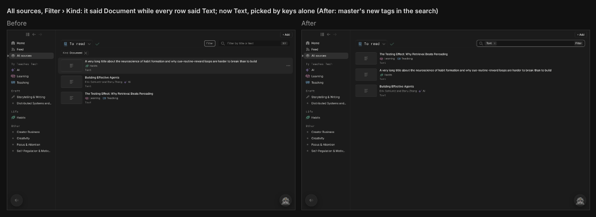
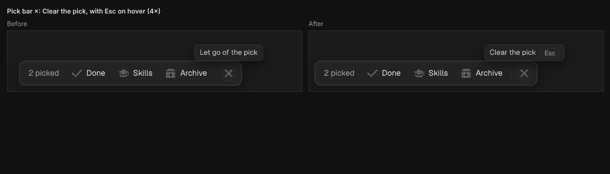
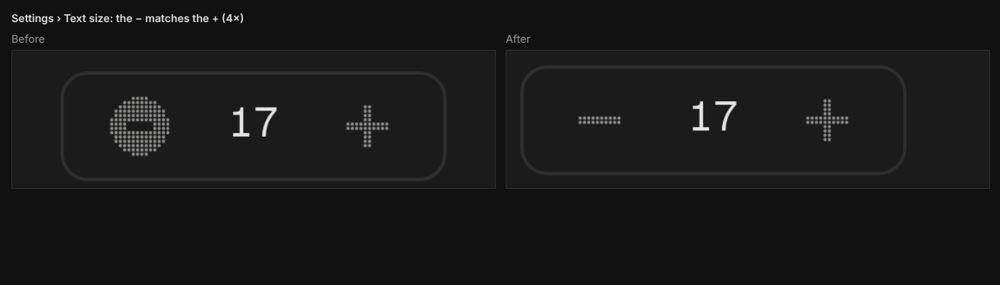
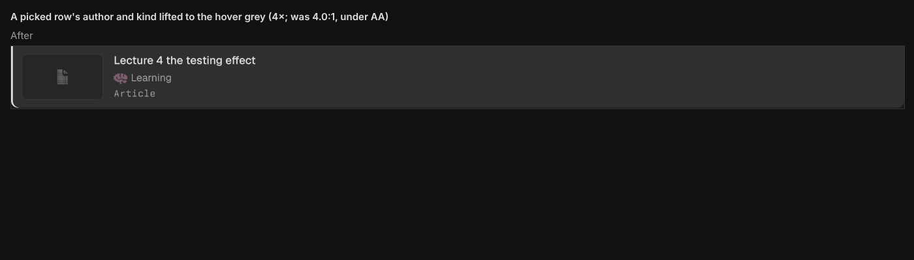
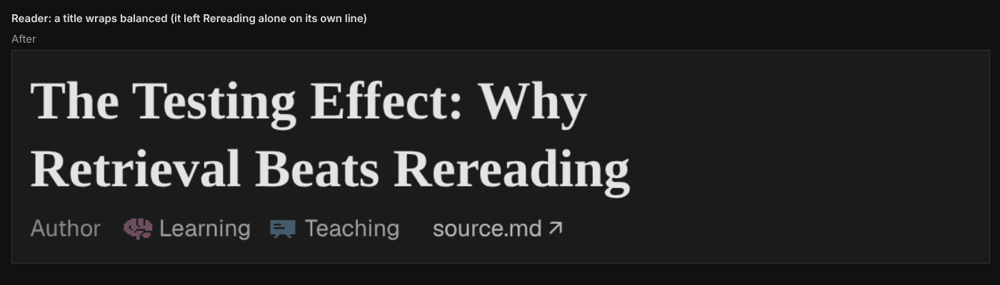

# Impeccable critique, round 9: Ore desktop (2026-11-15)

Method: dual-agent (A: design review on the mock app at 1280×800 @2×, the seeded library and, for Review and its end
screen, the demo library; B: `impeccable detect`, the CI gate, `style-check.ts`, the browser overlay on eleven states
and a mechanical pass), on master at bc0d275 (#398, the style rules change). Out of reach in the mock: a video source
(none seeded, so the video bar's named sections went unchecked) and the quick quiz (it waits for an event the mock
never sends). **Score: 30/40, level with rounds 7 and 8.** Trend: 26 → 28 → 30 → 30 → 28 → 29 → 30 → 30 → 30.

Detector: 11 counted findings, all in the CI baseline (as round 8). 170 advisory: three `#000` gone with the paper
button's lip (#398), three new off-scale literals from the filter and pick bars (#418: two radii, one border).
`impeccable-gate.ts`: no new findings. `style-check.ts`: clean, but it visits only Home, a skill page and the reader;
run over the other views it found the filter menu's sideways scroll (fixed below). Overlay: the known false ones
(Geist, D129; the spring easing, D185; Settings' padding; the popup over its selection) plus two real ones, both fixed:
a picked row's author at 4.0:1, and a reader title leaving one word alone. No interactive element without a name, no
icon-only button without a hover line, no `title=`, no "card" in UI text.

| # | Heuristic | Score | Round 8 | Key issue |
|---|---|---|---|---|
| 1 | Visibility of system status | 3 | 3 | Better: "2 picked" and the filter chip show state. Left: the memory line over the ratings explains itself only on hover |
| 2 | Match with the real world | 3 | 3 | "Lv 0"; pasted text was "Text" in Add and "Document" in the filter (fixed) |
| 3 | User control and freedom | 3 | 3 | Esc in the reader leaves the source when he meant something smaller |
| 4 | Consistency and standards | 3 | 3 | Better: types in sentence case, the lip only on answer keys. Left: two controls side by side called Filter |
| 5 | Error prevention | 3 | 3 | The eraser over the trash in the popup |
| 6 | Recognition rather than recall | 3 | 3 | Better: the pick bar shows what needed right-click. Left: ⌘K opens on 17 commands |
| 7 | Flexibility and efficiency | 4 | 4 | The filter's keyboard path stopped at its second step (fixed) |
| 8 | Aesthetic and minimalist design | 3 | 3 | ⌘K's long opening list; the Shortcuts sheet as one long scroll |
| 9 | Error recovery | 3 | 3 | A failed check still suggests no rating |
| 10 | Help and documentation | 2 | 2 | Meanings a hover away: highlight types, gems, "Lv 0"; Filter's button has no hover line |

Design-specificity: authored. The new pick bar and filter chips are borrowed (Linear) but drawn in the house style.
Cognitive load: 2 of 8 fail (minimal choices, working memory), as round 8; the new filter passes (three fields, then
one field's values). Emotional journey: a miss moves on with no scolding, and the end screen opens on the ring with
"Rocky one. Every miss comes back sooner."; the one valley is a session cut short right after a miss, which ends on it.

## Fixed in this PR
- **One kind of source had two names.** Filter › Kind said "Document", its rows and Add said "Text". One map now,
  and it says Text. 
- **Filter's values list ignored Enter**: no row was highlighted after Enter opened a field, so only ↓ then Enter
  worked. The first row is highlighted now, as in Linear; a search matching no field says "No filters match".
- **The pick bar's ×** said "Let go of the pick" with no key; the Shortcuts sheet says "Clear the pick · Esc". One
  name, Esc on hover. 
- **The − beside a +** (Text size, the diagram's zoom) was a filled disc beside a bare cross. Redrawn as the +'s bar.
  
- **A picked row's author and kind** stayed faint on the picked fill (4.0:1); they lift as on hover now.
  
- **Filter's list scrolled sideways by 2px**: its fade reached past the menu's 4px padding.
- **A reader title** could leave one word alone on its last line; it wraps balanced now.
  
- **Counts of one**: "1 lessons" on an iPhone course line, "1 of 1 key points are marked missed" in Review.
- **The goal in two wordings**: Home's "Anything more is a bonus" now matches Review's "The rest is extra".

## Raised with Tyler
1. **Two Filters in one field on All sources.** Since #419 the search field reads "Filter by title or text" with the
   word "Filter" at its end, which opens kind, skill or author (⌘K: "Filter sources"). Linear and Raindrop call the
   field Search, and so does a skill page ("Search sources"). Proposed: "Search by title or text", ⌘K's "Search sources".
2. **The pick bar's "Done"** can read as closing the bar (its hover says "Move 2 sources to Done"). Proposed: "Mark done".
3. When the passage shown after an answer says exactly what the answer says, show only "Open in source"?
4. Should a session cut short right after a miss get one likely win first (D177), so it never ends on the miss?

## What the review raised, and what held up
- The Shortcuts sheet's list ends hard where ⌘K's fades (D281 names the palette). Left.
- The filter chip's × draws at 20px in a 22px chip. Left for a 4× look on the Mac.
- ⌘C is "Copy with source" on a highlight and "Copy as Markdown" on sources; the Shortcuts row carries both. Left.

## Still open from earlier rounds
Hints in two forms (Review's key bar, hover elsewhere); "Lv 0"; the highlight types explained only on hover; a failed
check suggests no rating; ⌘K's long opening list; Esc in the reader.
