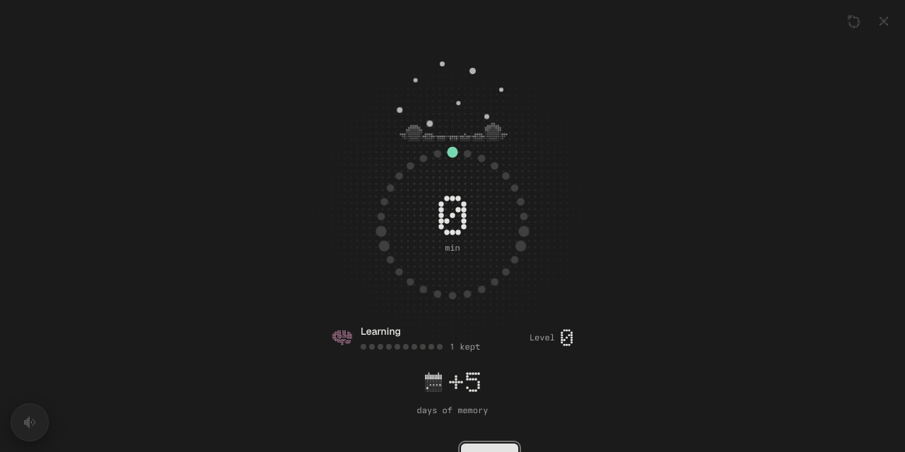
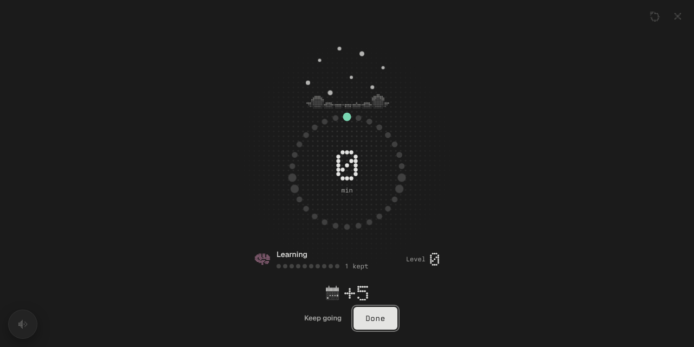
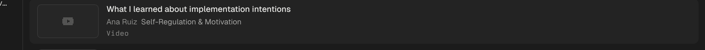
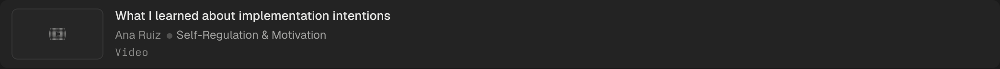

# Impeccable critique, round 10: Ore on the Mac and the iPhone (2026-11-23)

Method: dual-agent (A: design review of the mock app, Mac at 1280×800 and 720 wide @2×, iPhone at 390×844 with touch,
worst case first on the big library of 238 sources; B: `impeccable detect`, the CI gate, `style-check.ts` run over
every view, the browser overlay on nine pages and a mechanical pass), on master at 39aa453. Both ran in Chromium in the
cloud: no WebKit there, so the iPhone was looked at in Chromium's iPhone 14 emulation. Out of reach in the mock: a
video source, the quick quiz, AI results (so the byline's suggested skill), a Feed with posts.
**Score: 30/40, level with rounds 7, 8 and 9.** Trend: 26 → 28 → 30 → 30 → 28 → 29 → 30 → 30 → 30 → 30.

Detector: 11 counted findings, all in the CI baseline (as round 9). 184 advisory (170 in round 9; the new ones are
colour and radius literals, uncounted by the gate). `impeccable-gate.ts`: no new findings. `style-check.ts` over every
view: no off-ramp text and no stray scroll; two real ones, the filter tag's × (fixed below) and the end screen's skill
icon at 28px (left, below). Overlay: the known false ones (Geist, D129; the spring, D185) and one new false one (the
ticked to-do's glow keyframe). No control without a name, no rendered `title=`, no "card", no plural mistake, nothing
off screen at 390 or 720; 80-character and one-letter skill names and 200-character, no-space, CJK and emoji titles
held on every Mac screen.

| # | Heuristic | Score | Round 9 | Key issue |
|---|---|---|---|---|
| 1 | Visibility of system status | 3 | 3 | The end screen's ten dots sit beside "N kept" and read as a count of kept |
| 2 | Match with the real world | 3 | 3 | "Goal met" over "0 min" after a short catch-up; "Level 0" |
| 3 | User control and freedom | 3 | 3 | Better: Add keeps what he typed. Left: Esc in the reader |
| 4 | Consistency and standards | 3 | 3 | Better: Search and Mark done settled. New: iPhone names and gaps against the Mac (below) |
| 5 | Error prevention | 3 | 3 | No change |
| 6 | Recognition rather than recall | 3 | 3 | Better: ⌘K's New skill lands in the sidebar's field. Left: ⌘K's long opening list |
| 7 | Flexibility and efficiency | 4 | 4 | Held |
| 8 | Aesthetic and minimalist design | 3 | 3 | The end screen ran past a 1280×800 window (fixed) |
| 9 | Error recovery | 3 | 3 | Add's refusal names the reason and keeps the link |
| 10 | Help and documentation | 2 | 2 | Meanings still a hover away |

Design-specificity: authored. The pieces new since round 9 (Continue reading rows, the No skill row, the end screen's
skill rows, the iPhone's Filter sheet and pick bar) are drawn in the house style; the weak spots are edge data, not
style. Cognitive load: 2 of 8 fail, as round 9 (minimal choices, working memory). Emotional journey: the peak is the
end screen, and on a 13-inch Mac it ended with Done out of sight (fixed).

## Fixed in this PR
- **The end screen's Done sat under the window's foot** at 1280×800 with three skills kept. Done holds to the
  window's foot and the rows scroll under it.
   
- **A skill with no icon ran on from the author** on a source's row and on Home ("Ana Ruiz Self-Regulation &
  Motivation"). It shows its dot, as in the sidebar.
   
- **Settings opened on Reading** though General is first in its list (D347). A first open lands on General.
- **The open tab's name was cut mid-letter** ("To re") in a 720px window with three tabs and a filter tag. The search
  gives way instead.  
- **A highlighted filter row's count** was 3.97:1; it lifts to the muted grey.
- **A filter tag's ×** drew 2px wider than its button (seen in round 9 and left); the button is 20px.
- **iPhone: a sheet's back row** (Filter › Kind, Importance) was a 36 pt tap; it is 44.
- **iPhone: Search's sheet** was announced as "Command palette"; it is named Search.

## Raised with Tyler
1. **The end screen's ten dots beside "N kept"** are level progress, but read as a meter of kept ("1 kept" with no
   dot lit in one row, two lit in the next). (a) dots alone under the name, "N kept" at the right by Level; (b) dots
   only on a row that gained one.
2. **iPhone Sources rows show the title only**; the Mac's row has author, skills and kind. (a) one faint line
   "Author · Kind", as Today has; (b) skill icons at the row's right.
3. **iPhone Add takes links and files only**; the Mac saves pasted words as a Text source. Accept pasted text there?
4. **iPhone Search with text typed shows two ✕** side by side, one clears and one closes. (a) close becomes "Cancel",
   as iOS; (b) keep.

## Found and left
- Open rows: Tab into a list with no row current shows no focus; `title=` on the icon picker's cells and a
  transcript's timestamps.
- The end screen's skill icon is 28px, off the icon set's tuned sizes (20 or 40): part of D334's layout, his look.
- iPhone against the Mac: "Archive" in the drawer vs "Archived"; the + button is "Add a link" though its sheet also
  takes a file or photo; the reader's menu says "Finish" vs the Mac's "Finish source"; No skill has Select but no
  Filter; Filter › Skill has no find field for 15 skills; Today has no plan line or goal gear; Settings has no AI or
  Review rows; no Feed.
- "Goal met" over "0 min" after a sub-minute session; No skill emptied on purpose says "Nothing in To read matches
  these filters"; the Collected row's icon in the reader's menu is a question mark, the tab's is the stack.
- Dropped after a second look: the Shortcuts search has no ring (its caret is the mark, as ⌘K's field); the tutor's
  "nested frame" and icons "cut" at 720 (a floating layer; icons half-scrolled at the fold).

## Still open from earlier rounds
Hints in two forms; "Lv 0"; the highlight types explained only on hover; a failed check suggests no rating; ⌘K's long
opening list; Esc in the reader. The score won't move until Help does.
